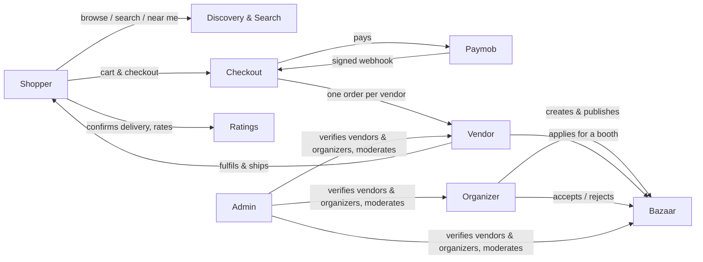
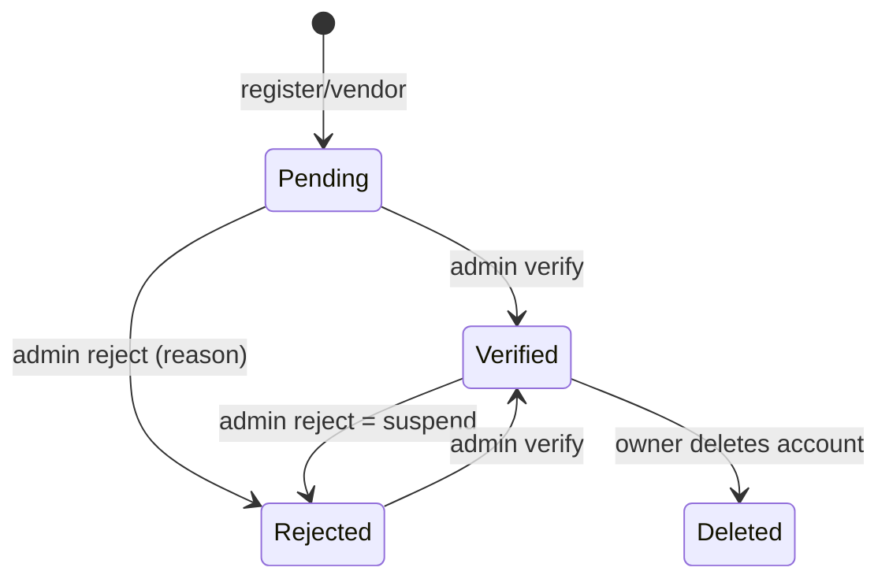
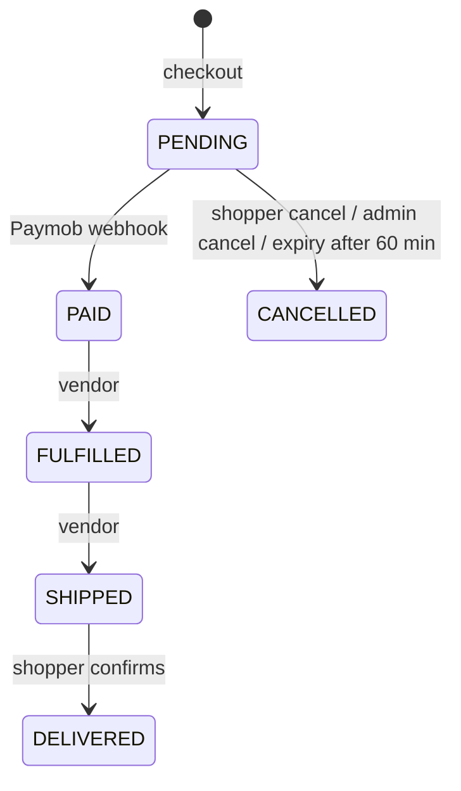
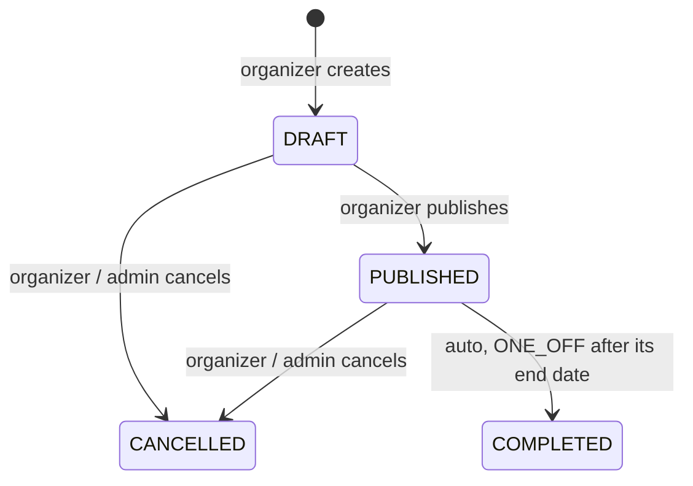
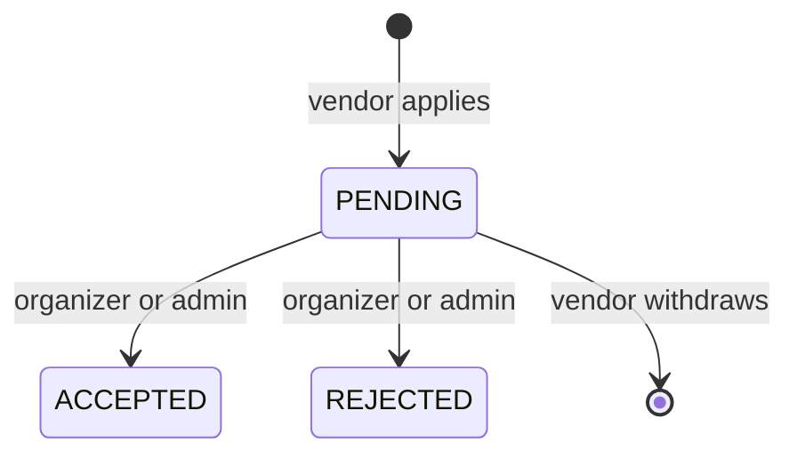
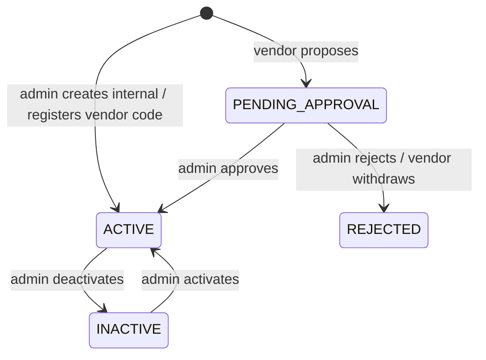

# Riven — How the platform works, A to Z

> **What this is:** one end-to-end description of every process the Riven API supports today — from registering an account to a delivered, rated order — written from the code, not from plans.
> **Who it is for:** the whole team: Ibrahim (product), backend developers, and whoever builds the mobile app, the web dashboard or the admin portal.
> **As of:** 2026-10-31, `apps/api` on `main` **plus the uncommitted work of 2026-10-28 – 10-31** (payment exceptions, stock constraints, stock ledger, checkout idempotency, reservation expiry, worker, outbox, health monitors, barcodes, security hardening). 145 HTTP routes.
> **Not a spec.** Specs (`specs/*-module-spec*.md`, `specs/commerce/`) say what *should* be built; this file says what *is* built. Where they differ, §15 lists it. Things that are planned but not built are in §16.

---

## Contents

1. [The big picture](#1-the-big-picture)
2. [Roles and who can see what](#2-roles-and-who-can-see-what)
3. [Accounts: register, log in, stay logged in](#3-accounts-register-log-in-stay-logged-in)
4. [Vendor onboarding](#4-vendor-onboarding)
5. [Catalog: categories, products, variants, images](#5-catalog-categories-products-variants-images)
6. [Shopper discovery: browse, search, near me, favorites](#6-shopper-discovery-browse-search-near-me-favorites)
7. [Buying: cart → checkout → payment → delivery](#7-buying-cart--checkout--payment--delivery)
8. [Ratings](#8-ratings)
9. [Bazaars: organizer, applications, booths](#9-bazaars-organizer-applications-booths)
10. [Admin: moderation and operations](#10-admin-moderation-and-operations)
11. [Barcodes (registry)](#11-barcodes-registry)
12. [Background processes](#12-background-processes)
13. [Monitoring and health](#13-monitoring-and-health)
14. [Rules that apply everywhere](#14-rules-that-apply-everywhere)
15. [Known gaps between the specs and the code](#15-known-gaps-between-the-specs-and-the-code)
16. [Not built yet](#16-not-built-yet)
17. [Endpoint index (all 145 routes)](#17-endpoint-index-all-145-routes)

---

## 1. The big picture

Riven connects three groups in Egypt:

- **Shoppers** discover local brands and bazaars, and buy fashion products online.
- **Vendors** (local brands) run a shop: a public profile, a product catalog, and booths at bazaars.
- **Organizers** run bazaars (markets/events): they create them, publish them, and accept vendor applications.

An **admin** approves vendors and organizers, moderates content and runs operations.

There are two product surfaces in one API:

| Surface | What happens | Main modules |
|---|---|---|
| **Discovery / bazaars** | Organizers publish bazaars; vendors apply for booths; shoppers find bazaars near them, follow, favorite and rate | `bazaars`, `booths`, `discovery`, `search`, `social` |
| **Fashion marketplace** | Vendors list products with variants; shoppers buy from several vendors in one cart; each vendor fulfils its own part | `vendors`, `products`, `cart`, `checkout`, `orders` |



**Tech in one line:** NestJS + Prisma + PostgreSQL/PostGIS (data and locations), Redis + BullMQ (background jobs), Meilisearch (search), S3-compatible storage (images), Paymob (card payments).

---

## 2. Roles and who can see what

Every account has exactly **one role**, chosen at registration and never changed by the API: `SHOPPER`, `VENDOR`, `ORGANIZER` or `ADMIN`. Nobody can register as `ADMIN` (refused in the service, not only in validation); the first admin is promoted by hand in the database.

| Role | Can |
|---|---|
| Shopper | browse, search, favorite, follow, cart, checkout, own orders, rate what they bought |
| Vendor | own shop profile and location, own products and variants, own orders, apply to bazaars, propose barcodes |
| Organizer | own profile, own bazaars (create, edit, publish, cancel), decide applications to their bazaars |
| Admin | everything under `/admin/*` — never through the owner routes |

**Visibility rules (what the public sees):**

| Thing | Public only when |
|---|---|
| Vendor shop | the vendor is **verified** by an admin and not deleted |
| Organizer | **verified** and not deleted (otherwise none of their bazaars are public) |
| Product | `isActive`, not deleted, and its **vendor is verified** and not deleted. Products have **no approval step** (removed 2026-09-27): public as soon as they are created |
| Bazaar | status **PUBLISHED**, not deleted, and its **organizer is verified** and not deleted |

Hidden things answer **404** on public routes (existence is not leaked). Admins can see everything through `/admin/*`.

---

## 3. Accounts: register, log in, stay logged in

### 3.1 Register

| Who | Route | What is created | Response |
|---|---|---|---|
| Shopper | `POST /auth/register` | a SHOPPER user | the user, **no tokens** — log in next |
| Vendor | `POST /auth/register/vendor` | a VENDOR user **and** its shop profile, in one transaction; shop starts **unverified** | tokens + user |
| Organizer | `POST /auth/register/organizer` | an ORGANIZER user and its organizer profile; starts **unverified** | tokens + user |

- Email is trimmed and lower-cased; an email already in use → `409 EMAIL_ALREADY_EXISTS` (also when two registrations race — the database index decides).
- Password (all three registrations): at least 8 characters with at least one digit.
- Limit: 10 per minute per source.

### 3.2 Log in and tokens

`POST /auth/login` → `{ accessToken (15 min), refreshToken (30 days), user }`.

- Wrong email and wrong password give the **same** answer, `401 INVALID_CREDENTIALS`, and — since 2026-10-29 — take the **same time** (an unknown email still costs one bcrypt comparison), so nobody can probe which emails exist.
- A deactivated account with the right password → `403 ACCOUNT_DEACTIVATED`. A deleted account looks like it never existed.
- Access tokens are JWTs signed and verified with **HS256 only**; tokens with another algorithm are rejected.
- Limit: 10 per minute per source → `429 RATE_LIMITED` with `Retry-After`.

**Refresh:** `POST /auth/refresh` with the refresh token → a new pair; the old refresh token is revoked (**rotation**). Re-using an already-rotated refresh token is treated as theft: **every session of that user is revoked**. Refresh tokens are stored hashed.

**Log out:** `POST /auth/logout` revokes one refresh token (always 204). The access token simply expires.

### 3.3 Profile and account

| Route | What |
|---|---|
| `GET /auth/me` | who the token belongs to |
| `GET /users/me`, `PATCH /users/me` | full profile; edit name, Egyptian phone, interests |
| `PATCH /users/me/location` | store current GPS point (for discovery); once per minute |
| `DELETE /users/me` | soft-delete own account after re-entering the password; all sessions revoked; a vendor's shop or organizer profile is soft-deleted too, so their products / bazaars leave public reads and search |

An admin can **deactivate** a user (sessions revoked, login answers 403) and **reactivate** them (§10).

---

## 4. Vendor onboarding



1. **Register** (`POST /auth/register/vendor`) with business name, category (`FASHION`, `FOOD`, `HOME_CRAFTS`, `BEAUTY`, `ACCESSORIES`, `KIDS`, `ART`, `OTHER`) and vendor type (`BAZAAR_ONLY`, `MARKETPLACE`, `BOTH`). The shop is **pending** and invisible.
2. **Admin verifies** (`PATCH /admin/vendors/:id/verify`) → the shop and its active products become public and searchable. Or **rejects** with a reason (`/reject`) — rejecting a verified vendor is how a vendor is **suspended**: shop and products leave public reads and search, and checkout refuses their products. Verifying again lifts it.
3. **Vendor completes the profile:** `PATCH /vendors/me` (description, brand story, policies, logo/banner/cover URLs, vendor type…) — never resets verification. `PATCH /vendors/me/location` sets the map point (once per minute).
4. **Uploads images** through presigned URLs (§5.4).
5. **Creates products** — only once verified (`403 VENDOR_NOT_VERIFIED` before).

Shoppers see a shop at `GET /vendors/:id` (public fields only — no owner id, subscription or rejection reason).

---

## 5. Catalog: categories, products, variants, images

### 5.1 Categories
A tree managed by the admin (`/admin/categories`: create, rename, re-slug, move, delete only when unused). Public `GET /categories` returns the tree. A product belongs to one category.

### 5.2 Products and variants
- **Product** = the item (title, description, category, base price in EGP, images, `isActive`).
- **Variant** = a sellable size/color of that product, with its own **SKU** (unique across the whole platform, not just per vendor), optional price override and **stock quantity**. Stock lives on the variant.

| Vendor route | What |
|---|---|
| `POST /vendors/me/products` | create (verified vendors only); public immediately if active |
| `GET /vendors/me/products`, `GET /vendors/me/products/:id` | own catalog incl. inactive |
| `PATCH /vendors/me/products/:id` | edit; stays public; re-indexed in search |
| `DELETE /vendors/me/products/:id` | soft delete (kept for order history) |
| `POST/PATCH/DELETE …/products/:id/variants[/:variantId]` | create, edit (size, color, SKU, price override) and soft-delete variants. A new variant may start with stock; **after that the PATCH no longer accepts `stockQuantity`** (400) |
| `POST …/variants/:variantId/stock-adjustments` | change stock by a **signed amount with a reason**: `{ "change": 5, "reason": "received from workshop" }` or `{ "change": -2, "reason": "two damaged" }`. Refused with `409 STOCK_BELOW_ZERO` if it would go below zero — so units already in shoppers' orders can never be taken back |
| `GET …/variants/:variantId/stock-movements` | the variant's stock history, newest first: every change with who, when, why, and the quantity before → after |

Public: `GET /products` (filters: category, vendor, text) and `GET /products/:id` (live variants + vendor summary).

### 5.2a Stock ledger
Every change to a variant's stock writes one row in the **stock ledger** (`inventory_movements`), in the same transaction as the change:

| Movement | Written by | Change |
|---|---|---|
| `OPENING_BALANCE` | the migration that started the ledger (2026-10-31) | the stock each variant had then |
| `VENDOR_ADJUSTMENT` | a vendor's signed change, including a new variant's initial stock | ± with the vendor's reason |
| `RESERVE` | checkout | − units, linked to the order group and the shopper |
| `RELEASE` | shopper cancel, admin cancel, expiry | + units, linked to the order group, tagged with who |

Rows are never edited or deleted (the database refuses), each row's before/after arithmetic is a database rule, and every stock change writes its movement in the same transaction, so the sum of a variant's movements equals its current stock. The only way they can differ is the deploy window (old code writing stock after the migration's opening balance); `/health/maintenance` then raises `LEDGER-DRIFT` and `apps/api/scripts/ledger-catch-up.sql` adds the catch-up rows. Admins read the ledger at `GET /admin/inventory-movements` (filters: variant, product, order group, type).

### 5.3 What an admin can do to products
Edit title / description / images only, or soft-delete. There is no approve/reject/hide (products have no approval gate). Every admin change is audited.

### 5.4 Images (presigned upload)
1. Vendor or organizer calls `POST /media/upload-url` with a purpose (`PRODUCT_IMAGE`, `VENDOR_LOGO`, `VENDOR_COVER`, `BAZAAR_COVER`), a type (`image/jpeg|png|webp`) and the file size `contentLength` in bytes (1 B – 10 MB).
2. The API returns a short-lived (5 min) `uploadUrl` and the final `publicUrl`. The file key is always under the caller's own folder with a fresh uuid, so nobody can overwrite someone else's file; the content type **and the exact size** are signed, so the storage refuses a different or bigger file.
3. The app `PUT`s the bytes to `uploadUrl`, then saves `publicUrl` in the product/vendor/bazaar.
- Limit: 30 per minute per user. Image URLs saved on products, vendors and bazaars must be `http://` or `https://` URLs with the scheme; they are not yet restricted to Riven's own storage (open product question).

---

## 6. Shopper discovery: browse, search, near me, favorites

| Need | Route | Notes |
|---|---|---|
| Bazaars near me | `GET /discovery/bazaars?lat&lng&radiusKm` | PostGIS distance, nearest first, 1–150 km (default 25), upcoming only by default, cursor paging; with a token each row has `isFavorite` |
| Search everything | `GET /search?q=` | Meilisearch; products, vendors and bazaars in one call |
| Search one kind | `GET /search/products|vendors|bazaars` | filters (category, price range, size, color, vendor type, schedule type, distance) and sorting |
| Browse lists | `GET /products`, `GET /bazaars` | database reads with filters |
| Favorite | `POST/DELETE/GET /social/favorites` | vendors, bazaars, products; shopper only to add; idempotent |
| Follow | `POST/DELETE/GET /social/follows` | vendors, bazaars; shopper only to add; idempotent |

Only **publicly visible** things are in the search index (§2). The index is updated by a background queue about 1–2 seconds after any change (§12).

---

## 7. Buying: cart → checkout → payment → delivery

### 7.1 Cart (shopper)
- `POST /cart/items` adds a variant (creates the cart on first use); the product must be public and the quantity must fit the current stock (soft check — the real check is at checkout).
- `PATCH /cart/items/:id` sets the quantity (0 removes), `DELETE /cart/items/:id`, `DELETE /cart` clears, `GET /cart` reads.
- One cart can hold items from **several vendors**.

### 7.2 Checkout (`POST /checkout`)

```mermaid
sequenceDiagram
  participant App as Shopper app
  participant API as Riven API
  participant DB as PostgreSQL
  participant PM as Paymob
  App->>API: POST /checkout
  API->>DB: one transaction with guarded writes:<br/>remove exactly the cart lines that were priced,<br/>create OrderGroup, one Order per vendor, price snapshots,<br/>decrement stock only if enough is left and the product<br/>is still public (fixed variant order)
  API->>PM: create payment intention (reference og:groupId)
  PM-->>API: intention id + client URL
  API-->>App: 201 OrderGroup + clientUrl (or paymentSetupFailed: true)
  App->>PM: shopper pays on Paymob's page
  PM->>API: POST /webhooks/paymob (HMAC-signed)
  API->>DB: record transaction once; PENDING orders → PAID
```

- **One checkout = one `OrderGroup`** with **one `Order` per vendor**, each with item **price snapshots** (later price changes don't affect it).
- **Stock is reserved at checkout**: each variant is decremented only while enough is left and the variant and its product are still public (not deleted, active, vendor verified) — re-checked inside the transaction, so a product withdrawn a moment earlier is never sold; if any line can't be covered, the whole checkout rolls back with `400 CHECKOUT_ITEM_UNAVAILABLE` and `details: { items: [{ cartItemId, variantId?, reason: PRODUCT_UNAVAILABLE | OUT_OF_STOCK }] }` for each bad line. Variants are always locked in the same order, so concurrent checkouts and cancels cannot deadlock. Tested: 10 buyers racing for the last 3 units → exactly 3 succeed.
- **Double taps can't make two orders**, even without a key: the checkout first removes exactly the cart lines it priced; a parallel request for the same cart waits, finds them gone, rolls back and re-reads the (now empty) cart → `400 CART_EMPTY` — even when the first request took the last units. Tested: 5 simultaneous submits → 1 order.
- The checkout transaction runs at READ COMMITTED and relies on these guarded writes; on heavy contention it retries automatically and, if it still can't finish, answers `503 CHECKOUT_CONTENDED` (safe to retry). Cancel and expiry run Serializable. The checkout, payment, cancel and expiry transactions have explicit time limits; a checkout attempt gives up on a blocked row after 5 s, and no new attempt starts after 20 s (whatever failed — contention or a changed cart), so a checkout (Paymob call included) always ends inside its key's 60 s lock.
- If Paymob can't be reached (or isn't configured locally) the orders still exist and the response says `paymentSetupFailed: true`; the app calls `POST /checkout/:orderGroupId/retry-payment` (owner only, still PENDING). If a payment page already exists for the group, retry-payment returns **that same page** instead of creating a second one, so two taps can never produce two live payment pages.
- **Retry safely with an `Idempotency-Key` header** (optional; any 8–128 characters of letters, digits, `.`, `_`, `:`, `-` — a UUID works). The first request with a key creates the order; any later request with the same key, within 24 hours, gets **the same order back** instead of a second one — even if the first response was lost on the network. While the first request is still running (up to 60 s), a duplicate gets `409 IDEMPOTENCY_KEY_IN_PROGRESS` — even if the order is already written; if the first request failed (e.g. out of stock), the key is freed and can be reused once the cart is fixed. Without the header, checkout behaves exactly as before.
- Limits: checkout and retry-payment 10 per minute per user (a script can't lock a product's whole stock).

### 7.3 Payment (Paymob webhook)
- One route, `POST /webhooks/paymob`, for the whole platform (limit 600 per minute). The HMAC signature is verified with a constant-time comparison; unsigned → 401. A correctly signed callback is still refused (and nothing stored) unless **every** signed field is present with its exact shape — JSON `true`/`false` (not `"true"`), integer ids and amount, a complete timestamp, a three-capital-letter currency — and its `integration_id` and `owner` equal the configured `PAYMOB_INTEGRATION_ID` and `PAYMOB_MERCHANT_ID`. Paymob signs the fields glued together with no separator, so without these rules someone holding one real signature could move digits from one field into its neighbour and still pass the check. Setting `PAYMOB_HMAC_SECRET` without both ids stops the API from starting.
- **Every signed callback is stored first** (`payment_provider_events`, never deleted or rewritten) and classified from signed fields only: payment, declined, pending, refund, void or other. Only a real payment is applied; a refund or void notification is never mistaken for a second charge. The same callback delivered again is a no-op; one that crashed half-way is processed again when Paymob retries it.
- The payment is matched **only on the order id Paymob signs** (`order.id`, compared with the Paymob order id stored when the payment page was created, or with the intention id for groups created before that id was stored), never on the unsigned reference and never on the transaction id. The transaction id is only used to recognise the same callback delivered twice.
- The decision is made **under the order group's row lock** — the same lock expiry and cancel take — and written in one transaction with its result:

| Situation | Result |
|---|---|
| right amount, EGP, orders still PENDING | every PENDING order → **PAID**; the group records this transaction as its payment |
| the same transaction again | nothing changes |
| a **second, different** charge on an already-paid group | **payment exception `DOUBLE_PAYMENT`** (both transactions stored; nothing applied twice) |
| the group was already cancelled or expired | orders stay cancelled, **exception `LATE_PAYMENT`** records the charge |
| amount ≠ the group total (piastres) | not paid, **exception `AMOUNT_MISMATCH`** records the charge |
| currency missing or not EGP | not paid, **exception `CURRENCY_MISMATCH`** records the charge |
| a signed charge that matches **no** order | **exception `UNMATCHED_PAYMENT`** (no order attached) |

Only a correct payment marks the group as paid. After a wrong charge the group stays **PENDING and unclaimed**: the shopper can still pay the right amount, and if they don't, expiry releases the stock as usual. The wrong charge stays on record as an exception until an admin resolves it (today: a manual refund). What to do with a **late** payment — refund it, or honour the order if stock is still there — is still an open business decision (BD-17, pending Ibrahim); the code only records it.

When more than one rule applies, the first match wins in this order: same transaction → nothing; group already paid → `DOUBLE_PAYMENT`; currency not EGP → `CURRENCY_MISMATCH`; group cancelled/expired → `LATE_PAYMENT`; wrong amount → `AMOUNT_MISMATCH`. (So a late charge in the wrong currency is recorded as `CURRENCY_MISMATCH`.)

- Payment exceptions are for a human: `GET /admin/payment-exceptions`, then `PATCH /admin/payment-exceptions/:id/resolve` with a note saying what was done (e.g. a manual refund). They are never deleted, their facts never change, resolving is audited, and `/health/maintenance` raises `PAY-EXC` while any is open. Resolving writes its audit row in the same transaction as the resolution. Refunds themselves are still manual (§16).

### 7.4 Order lifecycle



| Step | Who | Route |
|---|---|---|
| See own orders | shopper | `GET /orders`, `GET /orders/:id` |
| Cancel (only while PENDING) | shopper | `PATCH /orders/:id/cancel` — cancels the **whole checkout group** (all vendors) and restores stock |
| See incoming orders (with shopper contact) | vendor | `GET /vendors/me/orders`, `GET /vendors/me/orders/:id` — today this includes **PENDING (unpaid) and CANCELLED** orders with the shopper's contact; whether vendors should see unpaid orders is an open product question (BD-27) |
| Fulfil, then ship | vendor | `PATCH /vendors/me/orders/:id/status` with `FULFILLED` (from PAID) then `SHIPPED` (from FULFILLED) |
| Confirm delivery | shopper | `PATCH /orders/:id/confirm-delivery` (SHIPPED → DELIVERED) — unlocks rating |
| Cancel an unpaid order | admin | `PATCH /admin/orders/:id/cancel` — group-level, restores stock, audited; **no refunds** for paid orders |

Every status change is a guarded write (only from the expected state), so two people acting at once can't overwrite each other — the loser gets `409 ORDER_STATE_CHANGED`.

### 7.5 Abandoned checkouts: reservation expiry
A PENDING checkout holds stock. If it is not paid within **`CHECKOUT_PENDING_TTL_MINUTES` (default 60)** it is released:

- A background job runs **every 10 minutes** (§12). It finds PENDING groups older than the TTL **with no recorded payment**, locks each group, re-checks it, cancels its orders and restores the stock **exactly once**. A group someone else is touching right now is skipped and picked up by the next run; a paid group is never touched.
- So in practice a checkout is released between 60 and ~70 minutes after it was created.
- An admin can run it immediately: `POST /admin/maintenance/expire-overdue` with a `reason` (works even when Redis is down; audited on every call).
- Every run is recorded in `maintenance_runs` (status, counts, errors).

---

## 8. Ratings

- `POST /social/ratings` (shopper): score 1–5 and optional comment. **One rating per user per target** — posting again updates it.
- Rating a **vendor or product** requires the `orderId` of the shopper's own **DELIVERED** order containing it (verified purchase). Rating a **bazaar** needs no order (bazaar must be PUBLISHED or COMPLETED).
- Public: `GET /social/ratings/summary` (average, count) and `GET /social/ratings` (list with the reviewer's **name only**).
- Admin moderation: list with filters (e.g. low scores with comments), delete a rating, or clear only its comment (§10).

---

## 9. Bazaars: organizer, applications, booths

### 9.1 Organizer onboarding
Same as vendors (§4): register → pending → admin **verifies** or **rejects** (`/admin/organizers/:id/verify|reject`). Rejecting a verified organizer hides **all** their bazaars from public reads, discovery, search and applications; verifying again restores them. Organizers can edit only their name (`PATCH /organizers/me`).

### 9.2 Bazaar lifecycle



| Step | Who | Route |
|---|---|---|
| Create (verified organizers only) | organizer | `POST /organizers/me/bazaars` — name, description, cover images (max 10 http(s) URLs), location, `ONE_OFF` or `RECURRING` (+ rule), start/end dates (end never before start — also a DB constraint) |
| Edit | organizer | `PATCH /organizers/me/bazaars/:id` (re-indexed in search) |
| Publish | organizer | `PATCH …/:id/publish` (DRAFT only) → public, searchable, open to applications |
| Cancel | organizer or admin | `PATCH …/:id/cancel` — any status except COMPLETED |
| Complete | automatic | every 15 minutes, ONE_OFF bazaars past their end date → COMPLETED and removed from search |

Public reads: `GET /bazaars`, `GET /bazaars/:id` (with accepted, verified vendors), `GET /bazaars/:id/layout`.

### 9.3 Vendor applications



- A **verified** vendor applies: `POST /bazaars/:id/apply` (one application per bazaar; the bazaar must be public). Withdraw while pending: `DELETE /bazaars/:id/apply`. Own list: `GET /vendors/me/bazaar-applications`.
- The organizer sees applications for their bazaar and accepts/rejects (`/organizers/me/bazaars/:id/applications/...`); an admin can do the same on any bazaar (`/admin/applications`). **No reversals:** only PENDING applications can be decided; if both act at the same moment, one gets `409 APPLICATION_STATE_CHANGED`.

### 9.4 Booth layout (admin)
The admin draws the bazaar's grid and booths and assigns **accepted** applications to booths (`/admin/bazaars/:bazaarId/layout`, `/admin/booths/...`). A booth holds one application; an application can be in one booth. The public layout shows each booth with its vendor (name, logo) or empty. Organizer self-service layout editing is not built (§16).

---

## 10. Admin: moderation and operations

All admin routes are under `/admin/*`, need the ADMIN role, and **every write is recorded in the audit log** (who, what, target, reason). A repeated moderation action that changes nothing is a no-op and records nothing; the operational commands (manual expiry run, outbox drain, search reindex) are recorded on every accepted call, even when nothing changed.

| Area | What the admin can do |
|---|---|
| Dashboard | `GET /admin/overview` — pending vendors/organizers, users per role, orders by status, bazaars by status |
| Users | list, view, deactivate (sessions revoked), reactivate |
| Vendors | list (pending / verified / rejected), view in any state, verify, reject (= suspend), edit text and images |
| Organizers | list, verify, reject |
| Products | list, view in any state, edit text/images, soft delete |
| Stock ledger | `GET /admin/inventory-movements` — every stock change of every variant, read-only |
| Categories | list, create, update, delete if unused (search re-indexed) |
| Bazaars | list and view every bazaar incl. drafts, cancel |
| Applications | list, view, accept / reject pending |
| Booths | layout and booth CRUD, assign / unassign |
| Orders | list, view (incl. Paymob ids), cancel unpaid |
| Payment exceptions | list (by status, type, order group), view, resolve with a note — double, late, wrong-amount, wrong-currency and unmatched charges (§7.3) |
| Ratings | moderation list, delete, clear comment |
| Search | `POST /admin/search/reindex` (rebuild from the database) |
| Maintenance | `POST /admin/maintenance/expire-overdue` (§7.5) |
| Outbox | list deliveries, metrics, drain now, requeue a dead delivery (§12) |
| Barcodes | registry management (§11) |
| Audit | `GET /admin/audit-log` — filter by actor, target type, target, action |

There is no seeded admin: register a normal account and set `role = 'ADMIN'` in the database, then log in again.

---

## 11. Barcodes (registry)

Built 2026-10-29 (phase B1). A barcode links a scannable code to **one product variant** with a packaging conversion: **UNIT** = 1 item, **PACK** / **CASE** = `unitsPerPackage` (≥ 2) items.

Two kinds:
- **Vendor barcodes** — the code already printed on the vendor's product (unique per vendor). The vendor **proposes**, an admin **approves**; or an admin registers it directly.
- **Riven internal barcodes** — `RVN…` values generated by an admin (globally unique, with a check character) for items without a barcode. Vendors can't use the `RVN` prefix.



- **Lookup** (`POST /admin/barcodes/lookup` with value + vendor) answers `RESOLVED` (with variant and units), `BARCODE_UNKNOWN`, `VENDOR_MISMATCH`, `BARCODE_NOT_APPROVED`, `BARCODE_INACTIVE`, `BARCODE_AMBIGUOUS`, `VARIANT_UNAVAILABLE` or `BARCODE_INVALID_FORMAT`.
- A barcode's value, variant and packaging type never change; only an admin can change the units of a PACK/CASE (versioned).
- Every change is kept in an append-only history (`GET /admin/barcodes/:id` → `events`) and every admin action is audited.
- **Scanning sessions and stock changes by scan are not built yet** (phases B2–B5, §16).

---

## 12. Background processes

Jobs run on Redis + BullMQ. By default they run inside the API process (`PROCESS_ROLE=all`). **Reservation expiry and the outbox drain** can be moved to a separate worker (`PROCESS_ROLE=api` on the API + `pnpm start:worker` for the worker); search sync and bazaar auto-complete always stay in the API process.

| Job | When | What it does |
|---|---|---|
| **Search sync** | ~1–2 s after any write that changes searchable data | re-reads the entity from the database and adds/updates/removes it in Meilisearch; fan-out jobs re-index all products of a vendor or category, or all bazaars of an organizer, when those change |
| **Bazaar auto-complete** | every 15 min | ONE_OFF bazaars past their end date → COMPLETED, removed from search |
| **Reservation expiry** | every 10 min | releases unpaid checkouts older than the TTL (§7.5); records a run in `maintenance_runs`; optional heartbeat ping |
| **Outbox drain** | every 5 min | delivers stored events to their consumers with leases and retries (§ below) |
| **Schedule reconciler** | at boot and every 60 s | makes sure each schedule exists exactly once and recreates it if lost |

**Transactional outbox (infrastructure only):** an event is written in the same database transaction as the business change, so it can't be lost by a crash; deliveries are claimed with a lease, retried with backoff and marked DEAD after too many failures (an admin can requeue). **No module produces or consumes outbox events yet** — the first consumer will be notifications (§16).

**Domain events:** `bazaar.published` and `booth_listing.accepted` are emitted after their writes commit, but nothing listens to them yet (also waiting for notifications).

On shutdown (`SIGTERM`) the expiry job finishes the group it is on, records the run as interrupted, and the workers close cleanly.

---

## 13. Monitoring and health

| Route | Who | Answers |
|---|---|---|
| `GET /health` | public | always `{ status: ok }` if the process is up (for the host's health check) |
| `GET /health/dependencies` | header `x-health-token` | PostgreSQL and Redis up/down; 503 `DEPENDENCY_DOWN` when one is down |
| `GET /health/maintenance` | header `x-health-token` | background-job conditions (failed or stuck expiry runs, missing/overdue schedule, overdue checkouts, outbox backlog or dead deliveries) plus money and stock checks: open payment exceptions `PAY-EXC`, a payment callback stored but not processed for 15 min `PAY-STUCK`, a variant whose ledger sum ≠ its stock `LEDGER-DRIFT`; 503 `MAINTENANCE_ALERT` listing them |

The two token routes are disabled (404) unless `HEALTH_CHECK_TOKEN` is set. They are meant for an uptime monitor (none is connected yet).

---

## 14. Rules that apply everywhere

**Errors** always look like `{ "code": "SOME_CODE", "message": "…", "details"?: … }` so apps can branch on `code`. Unknown failures are a generic `500 INTERNAL_SERVER_ERROR` (details only in the server log). A database too busy to finish (serialization failure, deadlock, lock, statement or transaction timeout after the automatic retries) is `503 SERVICE_BUSY` — safe to retry — never a 500. Validation errors are `400 VALIDATION_ERROR`; unknown fields in a body are rejected.

**Rate limits** (per user when logged in, otherwise per IP):

| Route | Limit / min |
|---|---|
| everything (default) | 300 |
| register (3 routes), login | 10 |
| refresh | 30 |
| user / vendor location | 1 |
| checkout, retry payment | 10 |
| media upload URL | 30 |
| admin expire-overdue | 10 |
| admin outbox drain | 6 |
| vendor barcode propose | 60 |
| admin barcode lookup | 120 |
| Paymob webhook | 600 |

Over the limit → `429 RATE_LIMITED` with `Retry-After`. Behind a proxy, `TRUST_PROXY` must be set (e.g. `1`) or every user shares the proxy's IP.

**Data rules:**
- Things that history points at (users, vendors, products, variants, bazaars) are **soft-deleted**, never removed.
- Stock only changes through checkout, cancel/expiry and the vendor's signed adjustment, and each change is a ledger row (§5.2a); nothing sets stock to an absolute number after a variant exists.
- Multi-table writes are single transactions. Cancel, expiry and payment take the order group's row lock (Serializable for cancel/expiry); checkout uses READ COMMITTED with guarded "only if still true" writes. All retry automatically on a serialization failure or deadlock.
- The database itself refuses stock below zero and cart/order quantities of zero or less (CHECK constraints); such a write answers `409 CONSTRAINT_VIOLATION`.
- Ledger, payment-event and payment-exception rows are **append-only**: database triggers refuse deleting or rewriting them (tests clear them with `TRUNCATE`). Every hand-written constraint, trigger and special index is listed in `apps/api/prisma/hand-sql-objects.json`, and CI fails if one goes missing or the schema drifts from the migrations.
- Every concurrent action on the same thing has a guard (row lock or "only from this state" update): stock is never restored twice, an order is never both PAID and CANCELLED, an application or booth can't be decided/assigned twice.
- Prices are in EGP with 2 decimals; Paymob amounts are compared in integer piastres.
- Public responses never include passwords, owner emails, rejection reasons or internal ids beyond what the screen needs; admin-only fields stay on `/admin/*`.

**Security basics:** passwords hashed with bcrypt; refresh tokens stored hashed and rotated; JWT HS256 only; helmet headers; explicit CORS allow-list; signed, content-type- and size-locked uploads; in production the API refuses to start with the placeholder JWT secret or the published dev passwords; constant-time comparison for webhook and monitor secrets.

---

## 15. Known gaps between the specs and the code

| Topic | Spec says | Code does |
|---|---|---|
| `vendorType` (`BAZAAR_ONLY` / `MARKETPLACE` / `BOTH`) | separates the two surfaces | it is a **label only** (shown and searchable); nothing stops a `BAZAAR_ONLY` vendor from listing products or a `MARKETPLACE` vendor from applying to bazaars — needs a product decision |
| `riven-spec.md` §1 | "not e-commerce, no cart" | cart and checkout are built (the fashion addendum overrides it) |
| Error codes | every error coded | a wrong role is now `403 FORBIDDEN_ROLE`; some older errors still come back as `HTTP_ERROR` |

---

## 16. Not built yet

| Area | Status |
|---|---|
| **Refunds / Payments module** | no refund route; double, late, mismatched and unmatched charges are recorded as payment exceptions (§7.3) and handled manually (late payments: refund vs honour pending BD-17); paid-order cancellations are manual (spec pending) |
| **Notifications** (in-app, push, email) | not built; domain events and the outbox are ready for it |
| **Vendor subscriptions / organizer listing fees** | subscription status exists on the vendor; no billing |
| **Cash on delivery** | not built; would need method-aware expiry first |
| **Barcode scanning, intake, inventory** (B2–B5) | registry only; scanning sessions, intake/withdrawal and stock by scan wait for the inventory foundation and decisions BD-01 / BD-08 |
| **Organizer self-service booth layout** | admin only |
| **Events** (talks, meetups) | no spec yet |
| **Clients** | no mobile, web or admin app in this repo (a separate mobile app is being wired to this API) |
| **Production hosting, alerting, load tests** | paused (phase R4); see `specs/commerce/22` and `23` |
| **Approved but not built** | flat **80 EGP delivery fee per order** (FD-29), the **6 % markup** as a configurable value (FD-02), the cart **price-change review** CHANGED → REVIEWED (FD-21) — approved by Ibrahim, waiting for the pricing / delivery phases (`specs/commerce/08`) |
| **Payment attempts / reconciliation** (S5) | waits for Paymob activation and a sandbox check of the callback field names |

---

## 17. Endpoint index (all 145 routes)

"Who" = the role required. Every request is also in the Postman workspace "Riven" (17 collections).

**Auth** (7)

| Method | Path | Who |
|---|---|---|
| POST | `/auth/login` | public |
| POST | `/auth/logout` | public |
| GET | `/auth/me` | any logged-in |
| POST | `/auth/refresh` | public |
| POST | `/auth/register` | public |
| POST | `/auth/register/organizer` | public |
| POST | `/auth/register/vendor` | public |

**Users** (4)

| Method | Path | Who |
|---|---|---|
| DELETE | `/users/me` | any logged-in |
| GET | `/users/me` | any logged-in |
| PATCH | `/users/me` | any logged-in |
| PATCH | `/users/me/location` | any logged-in |

**Vendors (public)** (1)

| Method | Path | Who |
|---|---|---|
| GET | `/vendors/:id` | public |

**Vendor (own)** (20)

| Method | Path | Who |
|---|---|---|
| GET | `/vendors/me` | VENDOR |
| PATCH | `/vendors/me` | VENDOR |
| GET | `/vendors/me/barcodes` | VENDOR |
| POST | `/vendors/me/barcodes` | VENDOR |
| DELETE | `/vendors/me/barcodes/:id` | VENDOR |
| GET | `/vendors/me/bazaar-applications` | VENDOR |
| PATCH | `/vendors/me/location` | VENDOR |
| GET | `/vendors/me/orders` | VENDOR |
| GET | `/vendors/me/orders/:id` | VENDOR |
| PATCH | `/vendors/me/orders/:id/status` | VENDOR |
| GET | `/vendors/me/products` | VENDOR |
| POST | `/vendors/me/products` | VENDOR |
| DELETE | `/vendors/me/products/:id` | VENDOR |
| GET | `/vendors/me/products/:id` | VENDOR |
| PATCH | `/vendors/me/products/:id` | VENDOR |
| POST | `/vendors/me/products/:id/variants` | VENDOR |
| DELETE | `/vendors/me/products/:id/variants/:variantId` | VENDOR |
| PATCH | `/vendors/me/products/:id/variants/:variantId` | VENDOR |
| POST | `/vendors/me/products/:id/variants/:variantId/stock-adjustments` | VENDOR |
| GET | `/vendors/me/products/:id/variants/:variantId/stock-movements` | VENDOR |

**Organizer (own)** (11)

| Method | Path | Who |
|---|---|---|
| GET | `/organizers/me` | ORGANIZER |
| PATCH | `/organizers/me` | ORGANIZER |
| GET | `/organizers/me/bazaars` | ORGANIZER |
| POST | `/organizers/me/bazaars` | ORGANIZER |
| GET | `/organizers/me/bazaars/:id` | ORGANIZER |
| PATCH | `/organizers/me/bazaars/:id` | ORGANIZER |
| GET | `/organizers/me/bazaars/:id/applications` | ORGANIZER |
| PATCH | `/organizers/me/bazaars/:id/applications/:applicationId/accept` | ORGANIZER |
| PATCH | `/organizers/me/bazaars/:id/applications/:applicationId/reject` | ORGANIZER |
| PATCH | `/organizers/me/bazaars/:id/cancel` | ORGANIZER |
| PATCH | `/organizers/me/bazaars/:id/publish` | ORGANIZER |

**Products** (3)

| Method | Path | Who |
|---|---|---|
| GET | `/categories` | public |
| GET | `/products` | public |
| GET | `/products/:id` | public |

**Bazaars** (5)

| Method | Path | Who |
|---|---|---|
| GET | `/bazaars` | public |
| GET | `/bazaars/:bazaarId/layout` | public |
| GET | `/bazaars/:id` | public |
| DELETE | `/bazaars/:id/apply` | VENDOR |
| POST | `/bazaars/:id/apply` | VENDOR |

**Discovery & search** (5)

| Method | Path | Who |
|---|---|---|
| GET | `/discovery/bazaars` | public |
| GET | `/search` | public |
| GET | `/search/bazaars` | public |
| GET | `/search/products` | public |
| GET | `/search/vendors` | public |

**Social** (9)

| Method | Path | Who |
|---|---|---|
| DELETE | `/social/favorites` | SHOPPER |
| GET | `/social/favorites` | any logged-in |
| POST | `/social/favorites` | SHOPPER |
| DELETE | `/social/follows` | SHOPPER |
| GET | `/social/follows` | any logged-in |
| POST | `/social/follows` | SHOPPER |
| GET | `/social/ratings` | public |
| POST | `/social/ratings` | SHOPPER |
| GET | `/social/ratings/summary` | public |

**Cart & checkout** (7)

| Method | Path | Who |
|---|---|---|
| DELETE | `/cart` | SHOPPER |
| GET | `/cart` | SHOPPER |
| POST | `/cart/items` | SHOPPER |
| DELETE | `/cart/items/:itemId` | SHOPPER |
| PATCH | `/cart/items/:itemId` | SHOPPER |
| POST | `/checkout` | SHOPPER |
| POST | `/checkout/:orderGroupId/retry-payment` | SHOPPER |

**Orders (shopper)** (4)

| Method | Path | Who |
|---|---|---|
| GET | `/orders` | SHOPPER |
| GET | `/orders/:id` | SHOPPER |
| PATCH | `/orders/:id/cancel` | SHOPPER |
| PATCH | `/orders/:id/confirm-delivery` | SHOPPER |

**Media** (1)

| Method | Path | Who |
|---|---|---|
| POST | `/media/upload-url` | VENDOR, ORGANIZER |

**Payments** (1)

| Method | Path | Who |
|---|---|---|
| POST | `/webhooks/paymob` | Paymob (HMAC) |

**Health** (3)

| Method | Path | Who |
|---|---|---|
| GET | `/health` | public |
| GET | `/health/dependencies` | monitor token |
| GET | `/health/maintenance` | monitor token |

**Admin** (64)

| Method | Path | Who |
|---|---|---|
| GET | `/admin/applications` | ADMIN |
| GET | `/admin/applications/:id` | ADMIN |
| PATCH | `/admin/applications/:id/accept` | ADMIN |
| PATCH | `/admin/applications/:id/reject` | ADMIN |
| GET | `/admin/audit-log` | ADMIN |
| GET | `/admin/barcodes` | ADMIN |
| GET | `/admin/barcodes/:id` | ADMIN |
| PATCH | `/admin/barcodes/:id` | ADMIN |
| POST | `/admin/barcodes/:id/activate` | ADMIN |
| POST | `/admin/barcodes/:id/approve` | ADMIN |
| POST | `/admin/barcodes/:id/deactivate` | ADMIN |
| POST | `/admin/barcodes/:id/reject` | ADMIN |
| POST | `/admin/barcodes/internal` | ADMIN |
| POST | `/admin/barcodes/lookup` | ADMIN |
| POST | `/admin/barcodes/vendor` | ADMIN |
| GET | `/admin/bazaars` | ADMIN |
| GET | `/admin/bazaars/:bazaarId/layout` | ADMIN |
| PATCH | `/admin/bazaars/:bazaarId/layout` | ADMIN |
| POST | `/admin/bazaars/:bazaarId/layout` | ADMIN |
| POST | `/admin/bazaars/:bazaarId/layout/booths` | ADMIN |
| GET | `/admin/bazaars/:id` | ADMIN |
| PATCH | `/admin/bazaars/:id/cancel` | ADMIN |
| DELETE | `/admin/booths/:id` | ADMIN |
| PATCH | `/admin/booths/:id` | ADMIN |
| PATCH | `/admin/booths/:id/assign` | ADMIN |
| PATCH | `/admin/booths/:id/unassign` | ADMIN |
| GET | `/admin/categories` | ADMIN |
| POST | `/admin/categories` | ADMIN |
| DELETE | `/admin/categories/:id` | ADMIN |
| PATCH | `/admin/categories/:id` | ADMIN |
| GET | `/admin/inventory-movements` | ADMIN |
| POST | `/admin/maintenance/expire-overdue` | ADMIN |
| GET | `/admin/orders` | ADMIN |
| GET | `/admin/orders/:id` | ADMIN |
| PATCH | `/admin/orders/:id/cancel` | ADMIN |
| GET | `/admin/organizers` | ADMIN |
| PATCH | `/admin/organizers/:id/reject` | ADMIN |
| PATCH | `/admin/organizers/:id/verify` | ADMIN |
| GET | `/admin/payment-exceptions` | ADMIN |
| GET | `/admin/payment-exceptions/:id` | ADMIN |
| PATCH | `/admin/payment-exceptions/:id/resolve` | ADMIN |
| GET | `/admin/outbox` | ADMIN |
| GET | `/admin/outbox/deliveries/:id` | ADMIN |
| PATCH | `/admin/outbox/deliveries/:id/requeue` | ADMIN |
| POST | `/admin/outbox/drain` | ADMIN |
| GET | `/admin/outbox/metrics` | ADMIN |
| GET | `/admin/overview` | ADMIN |
| GET | `/admin/products` | ADMIN |
| DELETE | `/admin/products/:id` | ADMIN |
| GET | `/admin/products/:id` | ADMIN |
| PATCH | `/admin/products/:id` | ADMIN |
| GET | `/admin/ratings` | ADMIN |
| DELETE | `/admin/ratings/:id` | ADMIN |
| PATCH | `/admin/ratings/:id/clear-comment` | ADMIN |
| POST | `/admin/search/reindex` | ADMIN |
| GET | `/admin/users` | ADMIN |
| GET | `/admin/users/:id` | ADMIN |
| PATCH | `/admin/users/:id/deactivate` | ADMIN |
| PATCH | `/admin/users/:id/reactivate` | ADMIN |
| GET | `/admin/vendors` | ADMIN |
| GET | `/admin/vendors/:id` | ADMIN |
| PATCH | `/admin/vendors/:id` | ADMIN |
| PATCH | `/admin/vendors/:id/reject` | ADMIN |
| PATCH | `/admin/vendors/:id/verify` | ADMIN |
