# 02 — Data Model (ER diagram, Prisma proposal, hand-written SQL)

> Status: **DRAFT for review** · 2026-10-24. **No migration is generated from this document yet.** Phase assignment per model in §4; migration staging in `06-migration-plan.md`.

## 1. Conventions

- **Money:** integer minor units + `currency CHAR(3)` referencing `currencies.code`.
  - Per-document amounts (orders, payments, proofs, collections, refunds): `Int` — max 21,474,836.47 EGP per document, with `CHECK (amount >= 0)` and a per-currency cap enforced in the service.
  - Aggregates and ledger (`ledger_entries`, `courier_remittances`, `vendor_settlements`, `vendor_payouts`, `remittance_allocations`): `BigInt`. API responses serialize `BigInt` as a decimal **string** (`"105000"`) — decision FD-01/TD-05.
  - Catalogue prices stay `Decimal(12,2)`; conversion at the boundary with `toMinor(amount, currency)` using `currencies.minorUnits` (C4).
- **Keys:** UUID `String @id @default(uuid())` like the rest of the schema.
- **Deletion:** every FK has an explicit `onDelete`. Financial and inventory history rows use `Restrict` everywhere; nothing in this document is ever hard-deleted.
- **Append-only tables** (marked ⛔): UPDATE/DELETE blocked by trigger (§5).
- **Guarded state:** every `status` column changes only via `UPDATE … WHERE status = $from`.
- Columns `createdAt`/`updatedAt` omitted below where obvious.

## 2. ER diagram

```mermaid
erDiagram
  User ||--o{ OrderGroup : places
  OrderGroup ||--|{ Order : "one per vendor"
  Order ||--|{ OrderItem : contains
  OrderGroup ||--o{ PaymentTransaction : "attempts"
  PaymentTransaction ||--o{ PaymentProof : "transfer proofs"
  PaymentProof }o--|| PaymentReferenceClaim : claims
  PaymentReferenceClaim ||--o{ PaymentReferenceClaimEvent : history
  PaymentTransaction ||--o{ PaymentProviderEvent : "provider events"
  OrderGroup ||--o{ PaymentException : exceptions
  OrderGroup ||--o{ IdempotencyKey : "created by"

  Warehouse ||--o{ InventoryBalance : holds
  ProductVariant ||--o{ InventoryBalance : "stocked as"
  OrderItem ||--o{ StockReservation : reserves
  InventoryBalance ||--o{ StockReservation : "reserved from"
  InventoryBalance ||--o{ InventoryMovement : "changed by"
  Vendor ||--o{ InventoryIntake : delivers
  InventoryIntake ||--|{ InventoryIntakeLine : lines
  Stocktake ||--|{ StocktakeLine : lines

  OrderGroup ||--o{ Shipment : "shipped as"
  Shipment ||--|{ ShipmentItem : contains
  ShipmentItem }o--|| OrderItem : ships
  Courier ||--o{ Shipment : carries
  Shipment ||--o| CodCollection : "collects"
  Courier ||--o{ CourierRemittance : remits
  CourierRemittance ||--o{ RemittanceAllocation : "allocated to"
  CodCollection ||--o{ RemittanceAllocation : "paid by"
  CourierRemittance ||--o{ CourierDeduction : deducts

  OrderGroup ||--o{ ReturnRequest : returns
  ReturnRequest ||--|{ ReturnLine : lines
  OrderGroup ||--o{ Refund : refunds
  Refund ||--o{ RefundAttempt : attempts

  LedgerAccount ||--o{ LedgerEntry : posts
  LedgerJournal ||--|{ LedgerEntry : "balanced set"
  LedgerJournal |o--o| LedgerJournal : reverses
  Vendor ||--o{ VendorSettlement : "settled by"
  VendorSettlement ||--|{ SettlementLine : includes
  SettlementLine |o--|| LedgerEntry : "allocates (unique)"
  VendorSettlement ||--o{ VendorPayout : "paid by"

  OutboxEvent ||--o{ OutboxDelivery : "one per consumer"
  OutboxEvent ||--o{ ProcessedEvent : "consumed as"

  PricingConfigVersion ||--o{ OrderItem : "priced with"
  DeliveryZone ||--o{ DeliveryZoneArea : covers
  DeliveryZone ||--o{ DeliveryZoneRate : "priced by (versions)"
  DeliveryZoneRate ||--o{ OrderGroup : "fee snapshot"
  InventoryIntake ||--o{ IntakeVendorResponse : "vendor answers"
  IntakeVendorResponse ||--o| IntakeDispute : opens
  InventoryIntakeLine ||--o{ IntakeCorrection : "corrected by"
  OrderGroup ||--o{ FulfilmentEvent : timeline
  Vendor ||--o{ VendorStatement : "monthly"
  VendorStatement ||--|{ VendorStatementLine : explains
  VendorStatementLine }o--|| LedgerEntry : "traces to"
  VendorStatement ||--o| VendorSettlement : "settled by"
  Vendor ||--o{ VendorPayoutAccount : "paid to"
  VendorPayout ||--o{ PayoutReceiptConfirmation : "vendor confirms"
  PayoutReceiptConfirmation ||--o| PayoutDiscrepancy : "may raise"
```



## 3. Prisma proposal

### 3.1 New enums

```prisma
enum PaymentMethod        { PAYMOB TRANSFER COD }
enum PaymentChannel       { CARD PAYMOB_WALLET INSTAPAY VODAFONE_CASH ORANGE_CASH ETISALAT_CASH WE_PAY CASH }
enum OrderGroupStatus     { PLACED CONFIRMED COMPLETED CANCELLED }
enum FulfilmentMode       { VENDOR RIVEN }   // VENDOR = legacy groups shipped by the vendor (today's flow)
enum GroupPaymentStatus   { UNPAID AWAITING_REVIEW AWAITING_COLLECTION PAID PARTIALLY_REFUNDED REFUNDED REFUND_REQUIRED VOID }
enum PaymentTxStatus      { CREATED INITIATED INITIATION_FAILED PENDING_VERIFICATION AWAITING_COLLECTION SUCCEEDED FAILED EXPIRED CANCELLED PARTIALLY_REFUNDED REFUNDED }
enum ProofStatus          { SUBMITTED UNDER_REVIEW APPROVED REJECTED EXPIRED CANCELLED }
enum ProofRejectionKind   { NEEDS_CORRECTION FRAUDULENT }
enum ReferenceClaimStatus { CLAIMED VERIFIED REJECTED DISPUTED RELEASED }
enum ProviderEventStatus  { RECEIVED PROCESSED IGNORED FAILED }
enum PaymentExceptionType { LATE_PAYMENT AMOUNT_MISMATCH CURRENCY_MISMATCH DOUBLE_PAYMENT UNMATCHED_PAYMENT TRANSFER_SHORTFALL TRANSFER_OVERPAYMENT STOCK_UNAVAILABLE COD_SHORT_COLLECTION }
enum PaymentExceptionStatus { OPEN REFUND_IN_PROGRESS RESOLVED }
enum IdempotencyStatus    { IN_PROGRESS COMPLETED FAILED_RETRYABLE }

enum WarehouseKind        { RIVEN VENDOR_PREMISES }
enum ReservationStatus    { ACTIVE CONFIRMED FULFILLED RELEASED }
enum MovementType {
  OPENING_BALANCE
  RESERVE RELEASE                 // Phase 0 only (single stockQuantity counter)
  VENDOR_ADJUSTMENT
  INTAKE_ACCEPTED INTAKE_DAMAGED
  SHIPMENT_OUT
  RETURN_TO_QUARANTINE QUARANTINE_RELEASED QUARANTINE_DAMAGED
  MARK_DAMAGED DAMAGED_WRITE_OFF LOST_WRITE_OFF
  RETURN_TO_VENDOR
  ADMIN_ADJUSTMENT STOCKTAKE_ADJUSTMENT
}
enum IntakeStatus         { SUBMITTED RECEIVING RECEIVED VERIFIED DISPUTED CLOSED CANCELLED }
enum StocktakeStatus      { OPEN COUNTED PENDING_APPROVAL APPROVED CANCELLED }
enum AdjustmentStatus     { PENDING_APPROVAL APPROVED REJECTED }
enum DiscrepancyStatus    { OPEN ACKNOWLEDGED RESOLVED }

enum ShipmentStatus       { PENDING PREPARING READY_FOR_PICKUP HANDED_TO_COURIER OUT_FOR_DELIVERY DELIVERED FAILED_ATTEMPT REFUSED RETURNING RETURNED_TO_WAREHOUSE DAMAGED_IN_TRANSIT LOST CANCELLED }
enum CommerceRestriction  { NONE NO_NEW_LISTINGS NO_NEW_SALES PAYOUT_HOLD }   // PROPOSAL, pending BD-31 (C21)
enum FinancialDiscrepancyStatus { OPEN UNDER_INVESTIGATION RESOLVED ACCEPTED_AS_IS }
enum CodCollectionStatus  { NOT_COLLECTED COLLECTED_BY_COURIER PARTIALLY_COLLECTED COLLECTION_FAILED PARTIALLY_REMITTED REMITTED_TO_RIVEN RECONCILED DISPUTED WRITTEN_OFF }
enum RemittanceStatus     { RECORDED ALLOCATING ALLOCATED RECONCILED DISPUTED }
enum DeductionType        { DELIVERY_FEE COD_FEE RETURN_FEE FAILED_DELIVERY_FEE OTHER }

// Returns split into separate records (03 §9, RET-01; replaces the single ReturnStatus chain, 2026-10-25)
enum ReturnRequestStatus  { REQUESTED UNDER_REVIEW APPROVED REJECTED CLOSED CANCELLED }
enum ReturnShipmentStatus { AWAITING_PICKUP IN_TRANSIT RECEIVED LOST }
enum InspectionOutcome    { PENDING ACCEPTED_RESTOCK ACCEPTED_DAMAGED ACCEPTED_RETURN_TO_VENDOR REJECTED_RETURN_TO_CUSTOMER DISPUTED }
enum RefundStatus         { REQUESTED UNDER_REVIEW AWAITING_DESTINATION APPROVED PROCESSING COMPLETED FAILED RETRY_PENDING RETURNED_BY_BANK REJECTED CANCELLED }   // v6: destination states (15)
enum RefundDestinationSource { ORIGINAL_SENDER CUSTOMER_PROVIDED }
enum RefundDestinationType   { BANK_ACCOUNT INSTAPAY MOBILE_WALLET }
enum RefundDestinationStatus { PENDING_VERIFICATION VERIFIED REJECTED SUPERSEDED }
enum HoldLevel            { WORKFLOW ENTITY }               // TD-19 proposal (07 §14)
enum HoldStatus           { ACTIVE LIFT_REQUESTED LIFTED }
enum RefundMethod         { PAYMOB_API MANUAL_TRANSFER CASH }

enum LedgerAccountType    { ASSET LIABILITY EQUITY REVENUE EXPENSE }
enum EntryDirection       { DEBIT CREDIT }
enum JournalStatus        { DRAFT PENDING_APPROVAL POSTED DISCARDED }
enum SettlementStatus     { DRAFT PENDING_APPROVAL APPROVED PAYING PAID DISPUTED CANCELLED }
enum PayoutStatus         { PENDING SENT CONFIRMED FAILED CANCELLED }

enum OutboxDeliveryStatus { PENDING PROCESSING PROCESSED DEAD }   // retryable failure = back to PENDING with a later availableAt (01 §7.3)
enum StaffPermission      { OPS INVENTORY FINANCE FINANCE_APPROVER SUPPORT PLATFORM_OPERATOR DELIVERY_PRICING }

// vendor-facing and pricing additions (2026-10-25)
enum IntakeResponseType   { ACKNOWLEDGED DISPUTED }
enum IntakeDisputeStatus  { OPEN RESOLVED_UPHELD RESOLVED_REJECTED RESOLVED_PARTIAL }
enum FulfilmentEventType  { ORDER_PLACED PAYMENT_CONFIRMED ORDER_CONFIRMED PREPARING READY_FOR_PICKUP HANDED_TO_COURIER OUT_FOR_DELIVERY DELIVERY_FAILED DELIVERED REFUSED RETURN_REQUESTED RETURN_RECEIVED RETURN_INSPECTED CANCELLED LOST }
enum EventVisibility      { SHOPPER_AND_VENDOR VENDOR_ONLY INTERNAL }
enum StatementStatus      { DRAFT ISSUED SUPERSEDED_BY_ADJUSTMENT }
enum StatementLineKind    { SALE RETURN CANCELLATION ADJUSTMENT DEDUCTION PAYOUT OPENING_BALANCE }
enum ReceiptResponseType  { RECEIVED_FULL RECEIVED_PARTIAL DISPUTED }
enum PayoutDiscrepancyStatus { OPEN UNDER_INVESTIGATION RESOLVED }
enum PayoutDiscrepancyResolution { BANK_FEE_ABSORBED_BY_RIVEN BANK_FEE_CHARGED_TO_VENDOR PARTIAL_RETURN_TO_RIVEN TOP_UP_SENT VENDOR_CONFIRMED_ERROR OTHER }
enum PayoutAccountType    { BANK_ACCOUNT INSTAPAY WALLET }
enum ActorType            { USER SYSTEM PROVIDER }
```

### 3.2 Changes to existing models (additive)

```prisma
model User {
  // + ADMIN-only permission set (SD-01). Empty for other roles; enforced in service + CHECK.
  staffPermissions StaffPermission[] @default([])
}

model RefreshToken {
  // + per-device sessions (R23, SD-03)
  sessionId  String          // stable per device/browser login
  familyId   String          // rotation chain; reuse revokes this family only
  replacedById String?  @unique
  clientType String?         // 'web' | 'ios' | 'android' — informational only, never used for business rules
  @@index([familyId])
}

model Vendor {                       // PROPOSAL only (BD-31, BD-32, SD-09 pending; conflicts with admin-module-spec3 B1 — C21)
  commerceRestriction    CommerceRestriction @default(NONE)  // separate from `verified` (visibility) and `deletedAt` (termination)
  commerceRestrictedAt   DateTime?
  commerceRestrictionReason String?
  // existing `verified` / `rejectionReason` / `deletedAt` keep their meaning; vendor-module-spec3 §10 maps all four axes
}

model CartItem {                     // v7 logical fields (`20` §3.1) — proposal; no schema change now
  baselineUnitPriceMinor Int?        // last acknowledged price (or price when added)
  baselinePriceVersion   String?
  priceChangeStatus      String  @default("UNCHANGED")   // UNCHANGED | CHANGED | REVIEWED (evaluated lazily on read / checkout)
  priceChangedAt         DateTime?
  reviewedAt             DateTime?
  reviewedPriceVersion   String?
}

model ProductVariant {
  stockQuantity Int @default(0)   // UNCHANGED meaning: units a shopper can buy now.
                                  // Phase 0: authoritative. Phase 1b: trigger projection (see 06 §3).
  // + CHECK ("stockQuantity" >= 0)  (hand SQL)

  // Pricing (Phase 3, FD-02 / FD-17 / TD-14). Product.basePrice and priceOverride keep their columns;
  // their MEANING becomes "vendor rate" only if FD-17 option (a) is approved.
  vendorRateMinor     Int?       // = toMinor(priceOverride ?? product.basePrice)
  priceVersion        Int        @default(0)   // v7: +1 on every vendor-rate change; with pricingConfigVersionId forms the version a cart acknowledgment binds to (`20` §3.3)
  markupBps           Int?       // bps in force when customerPriceMinor was computed (600 = 6 %)
  customerPriceMinor  Int?       // vendorRateMinor + round_half_up(vendorRateMinor × markupBps / 10000)
  pricingConfigVersionId String?
  pricedAt            DateTime?
  // hand SQL: CHECK (customer_price_minor IS NULL OR customer_price_minor >= vendor_rate_minor)
}

model PricingConfigVersion {        // ⛔ append-only; one row per effective RIVEN_PROFIT_PERCENTAGE (TD-15)
  id            String   @id @default(uuid())
  percentText   String   // the env value as configured, e.g. "6" or "6.5"
  markupBps     Int      // 600
  effectiveFrom DateTime @default(now())
  deployId      String?  // build / release identifier
  recordedBy    String   // 'boot' or admin id for a re-pricing run
  @@map("pricing_config_versions")
  // hand SQL: CHECK (markup_bps BETWEEN 0 AND 5000)
}

model OrderGroup {
  // existing paymob* / paidAmountCents / paidAt KEPT as a compatibility projection (06 §4)
  status              OrderGroupStatus   @default(PLACED)
  fulfilmentMode      FulfilmentMode     @default(RIVEN)    // backfilled VENDOR for groups created before BD-02's go-live
  paymentMethod       PaymentMethod      @default(PAYMOB)   // empty-body checkout keeps today's behaviour
  paymentStatus       GroupPaymentStatus @default(UNPAID)
  currency            String             @default("EGP") @db.Char(3)
  itemsTotalMinor     Int                // Σ customer line totals (vendor rate + Riven profit) at checkout
  vendorTotalMinor    Int?               // Σ vendor line totals (Phase 3+)
  rivenProfitTotalMinor Int?             // Σ Riven profit lines (Phase 3+)
  deliveryFeeMinor    Int                @default(0)   // a.k.a. shipping fee; NOT marked up (FD-02)
  deliveryZoneId      String?            // zone resolved from the address (Phase 3)
  deliveryZoneRateId  String?            // the exact rate row applied — immutable snapshot
  totalMinor          Int                // items + delivery; the only amount a payment is checked against
  // hand SQL (Phase 3): CHECK (vendor_total_minor + riven_profit_total_minor = items_total_minor)
  paymentCode         String             @unique           // short code for transfer notes, e.g. RV-8F3A21
  reservationExpiresAt DateTime?         // current expiry of ACTIVE reservations
  reservationCapAt    DateTime           // hard cap: createdAt + MAX_RESERVATION; never extended
  // delivery snapshot (required for TRANSFER/COD; BD-11 decides PAYMOB)
  shipName            String?
  shipPhone           String?
  shipGovernorate     String?
  shipCity            String?
  shipStreet          String?
  shipNotes           String?
  confirmedAt         DateTime?
  cancelledAt         DateTime?
  cancelReason        String?
  version             Int                @default(0)       // bumped on every guarded state change (diagnostics)
  @@index([status, paymentStatus])
  @@index([reservationExpiresAt])
  // CHECKs (hand SQL): totalMinor = itemsTotalMinor + deliveryFeeMinor; all ≥ 0
}

model Order {
  status OrderStatus @default(PENDING)  // LEGACY PROJECTION — written only by projectLegacyOrderStatusInTx (03 §9)
}

model OrderItem {
  priceSnapshotMinor Int?   // added; backfilled from priceSnapshot (= customer unit price for legacy rows)
  // Pricing snapshot (Phase 3) — written once at checkout, never updated (hand SQL trigger blocks updates)
  vendorRateMinor        Int?   // per unit, what the vendor is owed
  markupBps              Int?   // e.g. 600
  rivenProfitMinor       Int?   // per unit
  customerUnitPriceMinor Int?   // per unit = vendorRateMinor + rivenProfitMinor
  pricingConfigVersionId String?
  // line amounts are unit × quantity (no per-line re-rounding, FD-20)
  // hand SQL: CHECK (customer_unit_price_minor = vendor_rate_minor + riven_profit_minor)
  // legacy rows (before Phase 3): vendorRate/markup NULL; treated per FD-17 in statements
}

model DeliveryZone {
  id        String   @id @default(uuid())
  code      String   @unique          // e.g. CAIRO_GIZA, DELTA, UPPER_EGYPT
  name      String
  isActive  Boolean  @default(true)
  areas     DeliveryZoneArea[]
  rates     DeliveryZoneRate[]
  @@map("delivery_zones")
}

model DeliveryZoneArea {             // location → zone mapping (BD-30); maker-checker
  id          String  @id @default(uuid())
  zoneId      String
  zone        DeliveryZone @relation(fields: [zoneId], references: [id], onDelete: Restrict)
  governorate String          // ISO 3166-2:EG code (fixed list of 27 in code)
  city        String?         // optional override; NULL = whole governorate
  status      String  @default("PENDING")   // PENDING | ACTIVE | RETIRED | REJECTED
  createdById String
  approvedById String?
  activatedAt DateTime?
  retiredAt   DateTime?
  @@map("delivery_zone_areas")
  // hand SQL: partial unique (governorate, city) NULLS NOT DISTINCT WHERE status = 'ACTIVE' — one active zone per area;
  //   CHECK (approved_by_id IS NULL OR approved_by_id <> created_by_id).
  // Approval retires the previous ACTIVE row and activates this one in the same transaction.
  // Orders snapshot deliveryZoneId + deliveryZoneRateId, so mapping history is never needed to explain an order.
}

model DeliveryZoneRate {             // ⛔ append-only: a fee change is a NEW row, never an update
  id            String   @id @default(uuid())
  zoneId        String
  zone          DeliveryZone @relation(fields: [zoneId], references: [id], onDelete: Restrict)
  feeMinor      Int
  currency      String   @db.Char(3)
  effectiveFrom DateTime
  createdById   String
  approvedById  String?
  createdAt     DateTime @default(now())
  @@unique([zoneId, effectiveFrom])
  @@map("delivery_zone_rates")
  // hand SQL: CHECK (fee_minor >= 0); maker-checker CHECK (approved_by_id <> created_by_id)
  // the rate in force = latest approved row with effective_from <= now()
}

model AdminAuditLog {      // TD-04
  actorId         String?             // was required; SYSTEM/PROVIDER actions have none
  actorType       ActorType @default(USER)
  source          String?             // route, job name, 'webhook:paymob'
  previousState   Json?
  newState        Json?
  correlationId   String?
  ledgerJournalId String?
  // + CHECK (actorType <> 'USER' OR actorId IS NOT NULL)
}
```

### 3.3 Checkout & idempotency

```prisma
model IdempotencyKey {
  id             String            @id @default(uuid())
  userId         String
  user           User              @relation(fields: [userId], references: [id], onDelete: Cascade)
  scope          String            // checkout | retry-payment | proof-submit | cancel | return-request
  key            String            @db.VarChar(128)
  requestHash    String            @db.Char(64)   // sha256 of canonical method+path+body
  status         IdempotencyStatus @default(IN_PROGRESS)
  lockedUntil    DateTime
  responseStatus Int?
  responseBody   Json?
  resourceType   String?
  resourceId     String?
  createdAt      DateTime          @default(now())
  expiresAt      DateTime
  @@unique([userId, scope, key])
  @@index([expiresAt])
  @@map("idempotency_keys")
}
```

### 3.4 Payments

```prisma
model PaymentTransaction {
  id                    String          @id @default(uuid())
  orderGroupId          String
  orderGroup            OrderGroup      @relation(fields: [orderGroupId], references: [id], onDelete: Restrict)
  attemptNo             Int
  method                PaymentMethod
  channel               PaymentChannel?
  status                PaymentTxStatus @default(CREATED)
  amountMinor           Int
  currency              String          @db.Char(3)
  // provider (PAYMOB)
  provider              String?         // 'PAYMOB'
  providerIntentId      String?
  providerOrderId       String?
  providerTransactionId String?
  providerStatus        String?         // last signed provider state, raw
  clientUrl             String?         // reopen the payment page while live (R25)
  initiatedAt           DateTime?
  expiresAt             DateTime?
  graceUntil            DateTime?
  succeededAt           DateTime?
  failedAt              DateTime?
  failureReason         String?
  refundedMinor         Int             @default(0)
  idempotencyKeyId      String?
  createdAt             DateTime        @default(now())
  updatedAt             DateTime        @updatedAt
  proofs                PaymentProof[]
  providerEvents        PaymentProviderEvent[]
  @@unique([orderGroupId, attemptNo])
  @@unique([provider, providerTransactionId])
  @@index([provider, providerOrderId])
  @@index([status, graceUntil])
  @@map("payment_transactions")
  // hand SQL: partial unique — at most one non-terminal attempt per group:
  //   UNIQUE (order_group_id) WHERE status IN ('CREATED','INITIATED','PENDING_VERIFICATION','AWAITING_COLLECTION')
  //   CHECK (refunded_minor BETWEEN 0 AND amount_minor)
}

model PaymentProviderEvent {            // ⛔ append-only except status/processedAt
  id                    String              @id @default(uuid())
  provider              String
  providerEventId       String              // Paymob: transaction id + event type (TQ-02)
  eventType             String
  signatureValid        Boolean
  payload               Json
  paymentTransactionId  String?
  paymentTransaction    PaymentTransaction? @relation(fields: [paymentTransactionId], references: [id], onDelete: Restrict)
  status                ProviderEventStatus @default(RECEIVED)
  outcome               String?             // paid | duplicate | orphan | amount_mismatch | ...
  correlationId         String?
  receivedAt            DateTime            @default(now())
  processedAt           DateTime?
  @@unique([provider, providerEventId])
  @@index([status, receivedAt])
  @@map("payment_provider_events")
}

model PaymentProof {
  id                    String             @id @default(uuid())
  paymentTransactionId  String
  paymentTransaction    PaymentTransaction @relation(fields: [paymentTransactionId], references: [id], onDelete: Restrict)
  orderGroupId          String             // denormalized for the partial unique index
  attemptNo             Int                // 1..BD-06 max
  channel               PaymentChannel
  senderPhone           String
  transactionRefRaw     String
  referenceClaimId      String
  referenceClaim        PaymentReferenceClaim @relation(fields: [referenceClaimId], references: [id], onDelete: Restrict)
  receivingAccountId    String             // which Riven account the shopper says they paid
  screenshotKey         String             // private storage key
  screenshotSha256      String             @db.Char(64)
  screenshotBytes       Int
  screenshotMime        String
  claimedAmountMinor    Int
  currency              String             @db.Char(3)
  status                ProofStatus        @default(SUBMITTED)
  submittedAt           DateTime           @default(now())
  reviewerId            String?
  reviewStartedAt       DateTime?
  reviewDueAt           DateTime           // SLA (BD-19)
  escalatedAt           DateTime?
  reviewedAt            DateTime?
  rejectionKind         ProofRejectionKind?
  rejectionReason       String?
  @@unique([orderGroupId, attemptNo])
  @@index([status, reviewDueAt])
  @@map("payment_proofs")
  // hand SQL: UNIQUE (order_group_id) WHERE status IN ('SUBMITTED','UNDER_REVIEW')
  // hand SQL: CHECK (status NOT IN ('APPROVED','REJECTED') OR (reviewer_id IS NOT NULL AND reviewed_at IS NOT NULL))
  // hand SQL: CHECK (status <> 'REJECTED' OR (rejection_kind IS NOT NULL AND rejection_reason IS NOT NULL))
}

model PaymentReferenceClaim {
  id              String               @id @default(uuid())
  channel         PaymentChannel
  normalizedRef   String
  orderGroupId    String               // current holder; reassigned only via RELEASED → CLAIMED
  status          ReferenceClaimStatus @default(CLAIMED)
  fraudFlag       Boolean              @default(false)  // set on REJECTED(fraud); never cleared except by dispute resolution
  proofs          PaymentProof[]
  events          PaymentReferenceClaimEvent[]
  @@unique([channel, normalizedRef])
  @@map("payment_reference_claims")
}

model PaymentReferenceClaimEvent {     // ⛔ append-only
  id            String                @id @default(uuid())
  claimId       String
  claim         PaymentReferenceClaim @relation(fields: [claimId], references: [id], onDelete: Restrict)
  fromStatus    ReferenceClaimStatus?
  toStatus      ReferenceClaimStatus
  orderGroupId  String
  actorId       String?
  approvedById  String?               // maker-checker transitions
  reason        String?
  evidenceKeys  String[]
  createdAt     DateTime              @default(now())
  @@map("payment_reference_claim_events")
  // hand SQL: CHECK (approved_by_id IS NULL OR approved_by_id <> actor_id)
}

model PaymentException {
  id              String                 @id @default(uuid())
  orderGroupId    String
  paymentTransactionId String?
  type            PaymentExceptionType
  status          PaymentExceptionStatus @default(OPEN)
  amountMinor     Int
  currency        String                 @db.Char(3)
  detail          Json
  refundId        String?
  resolvedById    String?
  resolution      String?
  createdAt       DateTime               @default(now())
  resolvedAt      DateTime?
  @@unique([paymentTransactionId, type])
  @@index([status, createdAt])
  @@map("payment_exceptions")
}

model ReceivingAccount {               // Riven's InstaPay / wallet accounts shown to shoppers
  id          String         @id @default(uuid())
  channel     PaymentChannel
  label       String
  identifier  String         // InstaPay address or wallet number
  isActive    Boolean        @default(true)
  ledgerAccountId String     // the ASSET account money lands in
  @@unique([channel, identifier])
  @@map("receiving_accounts")
}
```

### 3.5 Inventory

```prisma
model Warehouse {
  id        String        @id @default(uuid())
  kind      WarehouseKind
  name      String
  vendorId  String?       // set iff kind = VENDOR_PREMISES
  sellable  Boolean       @default(false)  // BD-08: may stock here be sold? Created false for every location;
                                           // RIVEN → true only by a recorded, audited configuration change once
                                           // intake exists; VENDOR_PREMISES stays false unless Ibrahim rejects BD-08
                                           // (06 §3.5, correction 01 §11.1)
  @@unique([vendorId])    // one premises location per vendor
  @@map("warehouses")
  // hand SQL: CHECK ((kind = 'VENDOR_PREMISES') = (vendor_id IS NOT NULL))
}

model InventoryBalance {
  id           String  @id @default(uuid())
  warehouseId  String
  variantId    String
  vendorId     String  // denormalized for vendor-scoped reads
  onHand       Int     @default(0)  // sellable-condition units physically present
  reserved     Int     @default(0)  // held by ACTIVE + CONFIRMED reservations
  damaged      Int     @default(0)
  quarantined  Int     @default(0)  // received/returned, awaiting inspection
  held         Int     @default(0)  // v7: on-hand units made unavailable by an active InventoryHold (dispute freeze, withdrawal) — `19` §7, §10.3
  @@unique([warehouseId, variantId])
  @@index([variantId])
  @@map("inventory_balances")
  // hand SQL: CHECK (reserved >= 0 AND held >= 0 AND on_hand >= reserved + held AND damaged >= 0 AND quarantined >= 0)
  // available = on_hand - reserved - held  (computed, never stored; v7 adds `held`)
  // physical  = on_hand + damaged + quarantined
}

model StockReservation {
  id             String            @id @default(uuid())
  orderItemId    String            @unique
  orderGroupId   String
  balanceId      String
  quantity       Int
  status         ReservationStatus @default(ACTIVE)
  expiresAt      DateTime?         // ACTIVE only
  confirmedAt    DateTime?
  fulfilledAt    DateTime?
  releasedAt     DateTime?
  releaseReason  String?
  @@index([status, expiresAt])
  @@index([orderGroupId])
  @@map("stock_reservations")
  // hand SQL: CHECK (quantity > 0); CHECK (status <> 'ACTIVE' OR expires_at IS NOT NULL)
}

model InventoryMovement {              // ⛔ append-only
  id               String       @id @default(uuid())
  warehouseId      String?      // null only for Phase 0 rows (single counter)
  variantId        String
  productId        String
  vendorId         String
  type             MovementType
  deltaOnHand      Int          @default(0)
  deltaReserved    Int          @default(0)
  deltaDamaged     Int          @default(0)
  deltaQuarantined Int          @default(0)
  deltaStockQuantity Int        @default(0)   // Phase 0 only
  origin           String?      // VENDOR_DECLARED (vendor-typed or migrated stock) | RIVEN_VERIFIED (intake,
                                // inspected restock, approved stocktake/adjustment) — classification for INV-07
  reason           String?
  sourceType       String       // CHECKOUT | CANCEL | INTAKE | SHIPMENT | RETURN | ADJUSTMENT | STOCKTAKE | MIGRATION ...
  sourceId         String
  sourceEventKey   String       @unique       // idempotency: e.g. 'reserve:<orderItemId>'
  actorId          String?
  actorType        ActorType
  correlationId    String?
  createdAt        DateTime     @default(now())
  @@index([variantId, createdAt])
  @@index([sourceType, sourceId])
  @@map("inventory_movements")
}

model InventoryAdjustmentRequest {     // v6 (17 §4.3, TD-08 pending): vendor request on Riven-held stock — decrease-only (INV-10)
  id            String   @id @default(uuid())
  vendorId      String
  variantId     String
  warehouseId   String   // a RIVEN warehouse
  delta         Int      // < 0 (CHECK)
  reasonCode    String   // DAMAGE_REPORTED | COUNT_ERROR (v7: WITHDRAW / RECALL now go through StockWithdrawal, `19` §10.3)
  explanation   String
  evidenceKeys  String[]
  status        String   @default("PENDING")   // PENDING | APPROVED | REJECTED | CANCELLED
  requestedById String   // vendor user
  reviewedById  String?  // INVENTORY (maker of the resulting adjustment)
  approvedById  String?  // FINANCE_APPROVER (checker)
  adjustmentId  String?  // the InventoryAdjustment created on approval
  rejectionReason String?
  createdAt     DateTime @default(now())
  @@index([vendorId, status])
  @@map("inventory_adjustment_requests")
  // hand SQL: CHECK (delta < 0); CHECK (approved_by_id IS NULL OR approved_by_id <> reviewed_by_id)
}

model InventoryAdjustment {            // maker-checker for admin/stocktake corrections
  id            String           @id @default(uuid())
  balanceId     String
  deltaOnHand   Int
  deltaDamaged  Int @default(0)
  reason        String
  requestedById String
  approvedById  String?
  status        AdjustmentStatus @default(PENDING_APPROVAL)
  @@map("inventory_adjustments")
  // hand SQL: CHECK (approved_by_id IS NULL OR approved_by_id <> requested_by_id)
}

model InventoryIntake {
  id           String       @id @default(uuid())
  vendorId     String
  warehouseId  String
  status       IntakeStatus @default(SUBMITTED)
  submittedAt  DateTime     @default(now())
  receivedById String?
  verifiedById String?
  disputeNote  String?
  lines        InventoryIntakeLine[]
  @@map("inventory_intakes")
}

model InventoryIntakeLine {          // v7 (`19` §2–3): field names aligned with the intake MVP brief
  id                          String @id @default(uuid())
  intakeId                    String
  intake                      InventoryIntake @relation(fields: [intakeId], references: [id], onDelete: Restrict)
  variantId                   String
  requestedQuantity           Int                 // was declaredQty
  physicallyReceivedQuantity  Int?                // was receivedQty
  missingQuantity             Int?                // = requested - received (stored, CHECK)
  acceptedQuantity            Int     @default(0)
  damagedQuantity             Int     @default(0)
  rejectedQuantity            Int     @default(0)
  pendingInspectionQuantity   Int     @default(0)
  rejectionReason             String?             // required when rejectedQuantity > 0
  inspectionStatus            String  @default("NOT_STARTED")   // NOT_STARTED | IN_PROGRESS | COMPLETED
  approvalStatus              String  @default("NOT_REVIEWED")  // NOT_REVIEWED | APPROVED | RETURNED_FOR_RECOUNT
  disputeStatus               String  @default("NO_DISPUTE")    // NO_DISPUTE | DISPUTE_SUBMITTED | UNDER_REVIEW | RESOLVED_FOR_VENDOR | RESOLVED_FOR_RIVEN | PARTIALLY_RESOLVED
  discrepancyAckStatus        String  @default("NOT_REQUIRED")  // NOT_REQUIRED | ACK_REQUIRED | ACKNOWLEDGED
  receivedById                String?
  inspectedById               String?
  inspectedAt                 DateTime?
  approvedById                String?             // single authorized admin (BD-38)
  approvedAt                  DateTime?
  @@unique([intakeId, variantId])
  @@map("inventory_intake_lines")
  // hand SQL: CHECK (all quantities >= 0);
  //   CHECK (physically_received_quantity IS NULL OR requested_quantity = physically_received_quantity + missing_quantity);
  //   CHECK (physically_received_quantity IS NULL OR physically_received_quantity = accepted_quantity + damaged_quantity + rejected_quantity + pending_inspection_quantity);
  //   CHECK (rejected_quantity = 0 OR rejection_reason IS NOT NULL);
  //   CHECK (approval_status <> 'APPROVED' OR (inspection_status = 'COMPLETED' AND pending_inspection_quantity = 0));
  // hand SQL trigger: once approval_status = 'APPROVED', counted columns are immutable (corrections = InventoryAdjustment)
}

model IntakeEvidence {               // ⛔ append-only (`19` §8); a correction supersedes, never replaces
  id            String   @id @default(uuid())
  intakeLineId  String
  category      String   // DAMAGED | MISSING | REJECTED | RECEIVING_REPORT | GENERAL
  storageKey    String?  // private bucket intake-evidence/…; null for text-only items
  description   String?
  visibility    String   // VENDOR_VISIBLE | INTERNAL
  checksum      String?
  uploadedById  String
  supersedesId  String?
  createdAt     DateTime @default(now())
  @@index([intakeLineId])
  @@map("intake_evidence")
}

model IntakeNote {                   // ⛔ append-only; internal notes never returned on vendor routes
  id String @id @default(uuid()); intakeId String; intakeLineId String?; body String
  visibility String; authorId String; createdAt DateTime @default(now())
  @@map("intake_notes")
}

model IntakeLineDispute {            // v7 (`19` §7) — supersedes IntakeVendorResponse / IntakeDispute below
  id               String   @id @default(uuid())
  intakeLineId     String
  category         String   // ACCEPTED | DAMAGED | REJECTED | MISSING
  disputedQuantity Int
  reason           String
  evidenceKeys     String[]
  status           String   @default("DISPUTE_SUBMITTED")  // DISPUTE_SUBMITTED | UNDER_REVIEW | RESOLVED_FOR_VENDOR | RESOLVED_FOR_RIVEN | PARTIALLY_RESOLVED
  holdId           String?  // the dispute freeze, ACCEPTED category only
  submittedById    String   // vendor user
  submittedAt      DateTime @default(now())
  resolvedById     String?  // single authorized admin (BD-38)
  resolution       String?
  resolvedAt       DateTime?
  adjustmentId     String?  // InventoryAdjustment created by the resolution, if any
  idempotencyKey   String
  @@unique([intakeLineId, idempotencyKey])
  @@map("intake_line_disputes")
  // hand SQL: CHECK (disputed_quantity > 0); partial UNIQUE (intake_line_id, category) WHERE status IN ('DISPUTE_SUBMITTED','UNDER_REVIEW')
}

model InventoryHold {                // v7: makes on-hand units unavailable without changing counted quantities
  id          String   @id @default(uuid())
  balanceId   String
  holdType    String   // DISPUTE_FREEZE | WITHDRAWAL
  sourceType  String   // INTAKE_LINE_DISPUTE | STOCK_WITHDRAWAL_LINE
  sourceId    String
  quantity    Int
  status      String   @default("ACTIVE")   // ACTIVE | RELEASED
  createdAt   DateTime @default(now())
  releasedAt  DateTime?
  @@unique([sourceType, sourceId])
  @@map("inventory_holds")
  // held on the balance = Σ ACTIVE holds (reconciled daily)
}

model StockWithdrawal {              // v7 (`19` §10.3): vendor withdrawal of unsold stock — separate from customer returns
  id                 String   @id @default(uuid())
  vendorId           String
  status             String   @default("REQUESTED")  // REQUESTED | UNDER_REVIEW | AUTHORIZED | REJECTED | DISPATCHED | RECEIPT_CONFIRMED | DISCREPANCY_RECORDED | CLOSED | CANCELLED
  requestedAt        DateTime @default(now())
  earliestProcessingAt DateTime                         // requestedAt + 4 days (BD-39)
  reviewedById       String?
  idempotencyKey     String
  lines              StockWithdrawalLine[]
  @@unique([vendorId, idempotencyKey])
  @@map("stock_withdrawals")
}

model StockWithdrawalLine {
  id                     String @id @default(uuid())
  withdrawalId           String
  withdrawal             StockWithdrawal @relation(fields: [withdrawalId], references: [id], onDelete: Restrict)
  variantId              String
  requestedQuantity      Int
  authorizedQuantity     Int?     // ≤ available at authorization
  dispatchedQuantity     Int?     // Riven's record; never overwritten by the vendor
  vendorReceivedQuantity Int?     // the vendor's record; never overwrites dispatched
  @@map("stock_withdrawal_lines")
  // hand SQL: CHECK (dispatched_quantity IS NULL OR dispatched_quantity <= authorized_quantity)
}

model HandoverDiscrepancy {          // v7 (`19` §10.4); append-only except guarded status fields
  id                    String   @id @default(uuid())
  direction             String   // INBOUND_INTAKE | OUTBOUND_WITHDRAWAL
  intakeLineId          String?
  withdrawalLineId      String?
  vendorId              String
  declaredQuantity      Int      // requested (inbound) or authorized (outbound)
  rivenQuantity         Int      // physically received (inbound) or dispatched (outbound)
  vendorConfirmedQuantity Int?   // outbound only
  discrepancyQuantity   Int
  recordedById          String
  createdAt             DateTime @default(now())
  ackStatus             String   @default("ACK_REQUIRED")  // ACK_REQUIRED | ACKNOWLEDGED
  acknowledgedById      String?
  acknowledgedAt        DateTime?
  reviewStatus          String   @default("OPEN")          // OPEN | UNDER_REVIEW | RESOLVED
  resolution            String?
  resolvedById          String?
  resolvedAt            DateTime?
  @@map("handover_discrepancies")
  // hand SQL: CHECK (discrepancy_quantity > 0); CHECK ((intake_line_id IS NULL) <> (withdrawal_line_id IS NULL))
}

// SUPERSEDED in v7 by IntakeLineDispute + HandoverDiscrepancy (`19`): kept here for history, not to be built.
model IntakeVendorResponse {         // ⛔ append-only — the vendor's acknowledgment or dispute, separate from Riven's record
  id            String             @id @default(uuid())
  intakeId      String
  vendorUserId  String
  type          IntakeResponseType
  lineIds       String[]           // disputed lines (empty for ACKNOWLEDGED = whole report)
  claimedQty    Json?              // per disputed line: what the vendor says was delivered/acceptable
  reason        String?
  evidenceKeys  String[]
  createdAt     DateTime           @default(now())
  @@index([intakeId])
  @@map("intake_vendor_responses")
}

model IntakeDispute {
  id            String              @id @default(uuid())
  intakeId      String
  responseId    String              @unique   // the DISPUTED response that opened it
  status        IntakeDisputeStatus @default(OPEN)
  resolvedById  String?
  approvedById  String?             // maker-checker
  resolution    String?
  @@map("intake_disputes")
}

// SUPERSEDED in v7: post-approval corrections and dispute outcomes use InventoryAdjustment (`19` §6); kept for history.
model IntakeCorrection {             // ⛔ append-only; the only way counts change after inspection
  id            String @id @default(uuid())
  intakeLineId  String
  disputeId     String?
  deltaAccepted Int
  deltaDamaged  Int    @default(0)
  deltaRejected Int    @default(0)
  reason        String
  createdById   String
  approvedById  String
  createdAt     DateTime @default(now())
  @@map("intake_corrections")
}

model Stocktake      { id String @id @default(uuid()); warehouseId String; status StocktakeStatus @default(OPEN); requestedById String; approvedById String?; lines StocktakeLine[]; @@map("stocktakes") }
model StocktakeLine  { id String @id @default(uuid()); stocktakeId String; stocktake Stocktake @relation(fields: [stocktakeId], references: [id], onDelete: Restrict); variantId String; expectedOnHand Int; countedOnHand Int?; countedDamaged Int?; @@unique([stocktakeId, variantId]); @@map("stocktake_lines") }

model InventoryDiscrepancy {
  id          String            @id @default(uuid())
  kind        String            // COUNTER_VS_MOVEMENTS | RESERVED_VS_RESERVATIONS | PROJECTION_VS_BALANCE | SHADOW_DIFF
  variantId   String
  warehouseId String?
  expected    Int
  actual      Int
  status      DiscrepancyStatus @default(OPEN)
  detectedAt  DateTime          @default(now())
  resolvedById String?
  resolution  String?
  @@index([status])
  @@map("inventory_discrepancies")
}
```

### 3.6 Fulfilment & COD

```prisma
model Courier { id String @id @default(uuid()); name String @unique; isActive Boolean @default(true); @@map("couriers") }

model CourierHandover {                // ⛔ append-only manifest: the courier accepts responsibility (COU-02)
  id              String   @id @default(uuid())
  courierId       String
  handedOverAt    DateTime
  courierRepName  String
  courierRepIdRef String?  // courier staff id / badge, as the courier contract defines (TQ-23)
  shipmentIds     String[] // every parcel on the manifest
  parcelCount     Int
  codTotalMinor   Int      // Σ COD amounts the courier accepts to collect
  evidenceKeys    String[] // signed manifest photo/scan (private storage), courier receipt
  recordedById    String   // OPS user
  @@map("courier_handovers")
  // hand SQL: CHECK (parcel_count = cardinality(shipment_ids)); a shipment moves to HANDED_TO_COURIER only with a manifest id
}

model Shipment {
  id              String         @id @default(uuid())
  orderGroupId    String
  sequence        Int            // 1 = original; >1 = re-delivery or split (BD-09)
  courierId       String?
  trackingNumber  String?
  status          ShipmentStatus @default(PENDING)
  attempts        Int            @default(0)
  codAmountMinor  Int            @default(0)   // 0 unless paymentMethod = COD
  currency        String         @db.Char(3)
  handedOverAt    DateTime?
  deliveredAt     DateTime?
  shopperConfirmedAt DateTime?
  items           ShipmentItem[]
  @@unique([orderGroupId, sequence])
  @@unique([courierId, trackingNumber])
  @@index([status])
  @@map("shipments")
}

model FulfilmentEvent {              // ⛔ append-only timeline for shopper and vendor views (status + timestamp)
  id            String              @id @default(uuid())
  orderGroupId  String
  orderId       String?             // set when the event concerns one vendor's order only
  shipmentId    String?
  type          FulfilmentEventType
  fromStatus    String?
  toStatus      String?
  occurredAt    DateTime            @default(now())
  visibility    EventVisibility     @default(SHOPPER_AND_VENDOR)
  note          String?             // vendor/shopper-safe text only; no internal data
  @@index([orderGroupId, occurredAt])
  @@index([orderId, occurredAt])
  @@map("fulfilment_events")
}
// Written in the same transaction as every group / shipment / return transition (W-workflows in 05 §2).

model ShipmentItem {
  id          String @id @default(uuid())
  shipmentId  String
  shipment    Shipment @relation(fields: [shipmentId], references: [id], onDelete: Restrict)
  orderItemId String
  quantity    Int
  @@unique([shipmentId, orderItemId])
  @@map("shipment_items")
}

model CodCollection {
  id                 String              @id @default(uuid())
  shipmentId         String              @unique
  orderGroupId       String
  courierId          String
  expectedMinor      Int
  collectedMinor     Int                 @default(0)   // reported by courier / ops
  remittedMinor      BigInt              @default(0)   // Σ allocations (maintained in the allocation tx)
  currency           String              @db.Char(3)
  status             CodCollectionStatus @default(NOT_COLLECTED)
  collectedAt        DateTime?
  evidenceKey        String?
  recordedById       String?
  recordedSource     String?
  @@index([courierId, status])
  @@map("cod_collections")
  // hand SQL: CHECK (collected_minor >= 0 AND remitted_minor >= 0 AND remitted_minor <= collected_minor)
}

model CourierRemittance {
  id              String           @id @default(uuid())
  courierId       String
  reference       String
  receivedMinor   BigInt           // what actually reached Riven's account
  reportedMinor   BigInt           // what the courier's statement says
  currency        String           @db.Char(3)
  receivedAt      DateTime
  receivingAccountId String
  status          RemittanceStatus @default(RECORDED)
  recordedById    String
  allocations     RemittanceAllocation[]
  deductions      CourierDeduction[]
  @@unique([courierId, reference])
  @@map("courier_remittances")
}

model RemittanceAllocation {           // ⛔ append-only; corrections are negative allocations with reason
  id             String @id @default(uuid())
  remittanceId   String
  remittance     CourierRemittance @relation(fields: [remittanceId], references: [id], onDelete: Restrict)
  collectionId   String
  amountMinor    BigInt            // may be negative only for a correction row
  reason         String?
  allocatedById  String
  createdAt      DateTime @default(now())
  @@index([collectionId])
  @@map("remittance_allocations")
}

model CourierDeduction {
  id            String        @id @default(uuid())
  remittanceId  String
  remittance    CourierRemittance @relation(fields: [remittanceId], references: [id], onDelete: Restrict)
  collectionId  String?
  shipmentId    String?
  type          DeductionType
  amountMinor   BigInt
  @@map("courier_deductions")
}
// Invariant (checked in the allocation tx under the L5 remittance lock, and by reconciliation):
//   Σ allocations(remittance) + Σ deductions(remittance) ≤ reportedMinor
//   unallocated = receivedMinor − Σ allocations(remittance)   (may be > 0 → UNALLOCATED_COURIER_CASH)
```

### 3.7 Returns & refunds

```prisma
// Five separate concepts (03 §9, RET-01): request → physical return → inspection → refund approval → refund execution.
// None of them creates or executes a refund by itself; a Refund is only REQUESTED from ACCEPTED inspection lines.
model ReturnRequest {                  // the customer's ask and Riven's decision to accept the return
  id String @id @default(uuid()); orderGroupId String; requestedById String
  status ReturnRequestStatus @default(REQUESTED); reason String
  reviewedById String?; reviewedAt DateTime?; rejectionReason String?
  lines ReturnLine[]; shipments ReturnShipment[]
  @@index([status]); @@map("return_requests")
}
model ReturnLine {                     // what the customer asked to return (quantity ≤ delivered − already returned)
  id String @id @default(uuid()); returnRequestId String
  returnRequest ReturnRequest @relation(fields: [returnRequestId], references: [id], onDelete: Restrict)
  orderItemId String; quantity Int
  inspections ReturnInspection[]
  @@unique([returnRequestId, orderItemId]); @@map("return_lines")
}
model ReturnShipment {                 // the physical return leg
  id String @id @default(uuid()); returnRequestId String
  returnRequest ReturnRequest @relation(fields: [returnRequestId], references: [id], onDelete: Restrict)
  status ReturnShipmentStatus @default(AWAITING_PICKUP)
  courierId String?; trackingNumber String?; receivedAt DateTime?; receivedById String?; evidenceKeys String[]
  @@map("return_shipments")
}
model ReturnInspection {               // ⛔ append-only per decision; a re-inspection is a new row referencing the previous
  id String @id @default(uuid()); returnLineId String
  returnLine ReturnLine @relation(fields: [returnLineId], references: [id], onDelete: Restrict)
  quantity Int; outcome InspectionOutcome; inspectedById String; inspectedAt DateTime @default(now())
  notes String?; evidenceKeys String[]; supersedesId String?
  @@map("return_inspections")
  // hand SQL: CHECK (quantity > 0); Σ ACCEPTED_* + REJECTED + DISPUTED per line ≤ line quantity (checked in the service under the line lock)
}

model Refund {
  id              String       @id @default(uuid())
  orderGroupId    String
  paymentTransactionId String
  returnRequestId String?
  inspectionIds   String[]     // ACCEPTED return inspections this refund covers (return refunds only)
  paymentExceptionId String?
  amountMinor     Int
  vendorShareMinor Int?        // part reversed from VENDOR_PAYABLE (FD-19 / FD-24); NULL = before delivery (nothing recognized)
  rivenShareMinor  Int?        // part reversed from RIVEN_PRODUCT_MARGIN or borne by Riven
  allocationReason String?     // required when the split is chosen by FINANCE_APPROVER (FD-24 safe default)
  currency        String       @db.Char(3)
  method          RefundMethod
  status          RefundStatus @default(REQUESTED)
  reason          String
  requestedById   String?
  approvedById    String?
  executedById    String?
  externalReference String?
  idempotencyKey  String       @unique      // passed to the provider (Paymob) or used as the transfer note
  attempts        RefundAttempt[]
  @@index([status])
  @@map("refunds")
  // hand SQL: CHECK (approved_by_id IS NULL OR approved_by_id <> requested_by_id)
  // hand SQL: partial unique — one COMPLETED refund per payment exception
}
model RefundDestination {             // v6, 15 §12 — FD-26 / SD-10 pending; append-style (never edited after VERIFIED/REJECTED)
  id                 String                  @id @default(uuid())
  refundId           String
  source             RefundDestinationSource
  type               RefundDestinationType
  holderName         String
  institution        String?                 // bank / wallet provider
  identifierEnc      Bytes                   // encrypted IBAN / IPA / wallet number (key management TQ-21)
  identifierLast4    String
  identifierHash     String                  // normalized hash: flags the same destination across customers
  status             RefundDestinationStatus @default(PENDING_VERIFICATION)
  verificationMethod String?                 // ORIGINAL_TXN_MATCH | NAME_CHECK+OTP | NAME_CHECK+CALL ...
  verifiedById       String?
  verifiedAt         DateTime?
  evidenceKeys       String[]
  usableFrom         DateTime?               // cooling-off end for CUSTOMER_PROVIDED
  submittedById      String
  createdAt          DateTime                @default(now())
  @@index([refundId]); @@index([identifierHash])
  @@map("refund_destinations")
}
// Refund (v6 additions, 15 §12): destinationId, destinationSnapshot Json (masked + encrypted copy), executedFromAccountId,
//   beneficiaryNameShown, proofKey — frozen after COMPLETED (trigger refunds_frozen_after_completed).

model FinancialHold {                  // v6, 07 §14 — TD-19 / FD-27 pending
  id              String     @id @default(uuid())
  level           HoldLevel
  workflow        String?    // PAYOUT_SEND | PAYOUT_CONFIRM | REFUND_APPROVAL | REFUND_EXECUTION | SETTLEMENT_APPROVAL | STATEMENT_ISSUE | MANUAL_ADJUSTMENT | COD_RECONCILE | ACCOUNT_VERIFICATION
  entityType      String?    // VENDOR | ORDER_GROUP | CUSTOMER | PAYOUT_ACCOUNT | SETTLEMENT | COURIER | REFUND
  entityId        String?
  status          HoldStatus @default(ACTIVE)
  reason          String
  activatedById   String
  activatedAt     DateTime   @default(now())
  liftRequestedById String?
  liftReason      String?
  liftedById      String?
  liftedAt        DateTime?
  @@index([level, workflow, status]); @@index([entityType, entityId, status])
  @@map("financial_holds")
  // hand SQL: CHECK (lifted_by_id IS NULL OR lifted_by_id <> lift_requested_by_id)
}
model FinancialHoldControl {           // the L0 lock target: one permanent row per holdable workflow (07 §14.4)
  workflow     String  @id
  activeHoldId String?                 // set while a workflow-level hold is ACTIVE / LIFT_REQUESTED
  @@map("financial_hold_controls")
}

model RefundAttempt { id String @id @default(uuid()); refundId String; refund Refund @relation(fields: [refundId], references: [id], onDelete: Restrict); attemptNo Int; status String; failureReason String?; providerRef String?; createdAt DateTime @default(now()); @@unique([refundId, attemptNo]); @@map("refund_attempts") }
// Invariant: Σ COMPLETED refunds(paymentTransaction) ≤ amount (enforced under the L1 group lock + payment_transactions.refunded_minor CHECK)
```

### 3.8 Ledger & settlements

```prisma
model Currency { code String @id @db.Char(3); minorUnits Int; @@map("currencies") }   // seed: EGP, 2

model LedgerAccount {
  id          String            @id @default(uuid())
  code        String            // e.g. VENDOR_PAYABLE
  type        LedgerAccountType
  currency    String            @db.Char(3)
  vendorId    String?
  courierId   String?
  isActive    Boolean           @default(true)
  @@unique([code, currency, vendorId, courierId])   // NULLS NOT DISTINCT in hand SQL (PG15+)
  @@map("ledger_accounts")
}

model LedgerJournal {
  id                String        @id @default(uuid())
  status            JournalStatus
  sourceType        String
  sourceId          String
  postingKind       String
  payloadHash       String        @db.Char(64)
  description       String
  reversesJournalId String?       @unique
  reversedByJournalId String?     @unique
  createdById       String?
  approvedById      String?
  process           String?       // job/webhook name for system postings
  correlationId     String?
  createdAt         DateTime      @default(now())
  postedAt          DateTime?
  entries           LedgerEntry[]
  @@unique([sourceType, sourceId, postingKind])
  @@map("ledger_journals")
  // hand SQL: CHECK (status <> 'POSTED' OR posted_at IS NOT NULL)
  // hand SQL: CHECK (approved_by_id IS NULL OR approved_by_id <> created_by_id)
}

model LedgerEntry {                    // ⛔ immutable once its journal is POSTED
  id           String         @id @default(uuid())
  journalId    String
  journal      LedgerJournal  @relation(fields: [journalId], references: [id], onDelete: Restrict)
  accountId    String
  direction    EntryDirection
  amountMinor  BigInt
  currency     String         @db.Char(3)
  orderGroupId String?
  shipmentId   String?
  vendorId     String?
  settlementLine SettlementLine?
  createdAt    DateTime       @default(now())
  @@index([accountId, createdAt])
  @@index([vendorId, createdAt])
  @@map("ledger_entries")
  // hand SQL: CHECK (amount_minor > 0)
}

model VendorStatement {              // the periodic document the vendor reads (monthly, BD-28)
  id               String          @id @default(uuid())
  vendorId         String
  periodStart      DateTime
  periodEnd        DateTime        // exclusive; Africa/Cairo month boundary converted to UTC
  currency         String          @db.Char(3)
  status           StatementStatus @default(DRAFT)
  openingBalanceMinor BigInt       // vendor balance at periodStart (ledger)
  salesMinor       BigInt          // Σ SALE lines
  returnsMinor     BigInt          // Σ RETURN + CANCELLATION lines (≤ 0)
  adjustmentsMinor BigInt
  deductionsMinor  BigInt          // agreed deductions (≤ 0)
  payoutsMinor     BigInt          // payouts made in the period (≤ 0)
  closingBalanceMinor BigInt       // opening + all of the above; must equal the ledger balance at periodEnd
  payableNowMinor  BigInt          // eligible amount (FD-03) — what the settlement will pay
  generatedById    String
  issuedAt         DateTime?
  lines            VendorStatementLine[]
  @@unique([vendorId, periodStart, currency])
  @@map("vendor_statements")
  // hand SQL: CHECK (closing = opening + sales + returns + adjustments + deductions + payouts)
  // hand SQL trigger: ISSUED statements and their lines are immutable
}

model VendorStatementLine {
  id              String            @id @default(uuid())
  statementId     String
  statement       VendorStatement   @relation(fields: [statementId], references: [id], onDelete: Restrict)
  kind            StatementLineKind
  ledgerEntryId   String            // every line traces to exactly one ledger entry
  orderGroupId    String?
  orderItemId     String?
  productId       String?
  productTitle    String?           // snapshot for display
  variantSku      String?
  quantity        Int?
  vendorUnitRateMinor Int?
  amountMinor     BigInt            // signed: + owed to vendor, − owed by vendor / paid
  occurredAt      DateTime          // sale date = delivery date (FD-03); return date; payout date
  explanation     String            // e.g. "3 × 500.00 EGP vendor rate, order RV-8F3A21, delivered 2026-11-04"
  eligible        Boolean           // part of payableNowMinor?
  @@unique([statementId, ledgerEntryId])
  @@map("vendor_statement_lines")
}

model VendorSettlement {
  id            String           @id @default(uuid())
  vendorId      String
  statementId   String?          // the statement whose payable this settles (required from Phase 6)
  currency      String           @db.Char(3)
  periodEnd     DateTime
  totalMinor    BigInt           // Σ lines, fixed at PENDING_APPROVAL
  status        SettlementStatus @default(DRAFT)
  createdById   String
  approvedById  String?
  lines         SettlementLine[]
  payouts       VendorPayout[]
  @@index([vendorId, status])
  @@map("vendor_settlements")
  // hand SQL: CHECK (approved_by_id IS NULL OR approved_by_id <> created_by_id)
}

model SettlementLine {
  id             String           @id @default(uuid())
  settlementId   String
  settlement     VendorSettlement @relation(fields: [settlementId], references: [id], onDelete: Restrict)
  ledgerEntryId  String           @unique     // a payable entry can be allocated to ONE settlement, ever
  ledgerEntry    LedgerEntry      @relation(fields: [ledgerEntryId], references: [id], onDelete: Restrict)
  signedMinor    BigInt           // credit to VENDOR_PAYABLE = +, debit (clawback) = −
  @@map("settlement_lines")
}
// Lines are never deleted. When a DRAFT / PENDING_APPROVAL settlement is CANCELLED, its lines are
// released by inserting SettlementLineRelease rows in the same transaction, which frees their payable
// entries for a later settlement. The "one live settlement per payable" rule is therefore a partial
// unique index on settlement_lines(ledger_entry_id) WHERE released = false (hand SQL; `released` is a
// boolean column set in the same tx as the release row). The `@unique` shown above becomes that index.

model SettlementLineRelease {          // ⛔ append-only
  settlementLineId String   @id
  releasedById     String
  reason           String
  releasedAt       DateTime @default(now())
  @@map("settlement_line_releases")
}

model VendorPayout {                 // Riven's record of the transfer — never editable by the vendor
  id             String       @id @default(uuid())
  settlementId   String
  settlement     VendorSettlement @relation(fields: [settlementId], references: [id], onDelete: Restrict)
  statementId    String       // denormalized: every payout references its statement
  attemptNo      Int
  amountMinor    BigInt
  method         String       // BANK_TRANSFER | INSTAPAY | WALLET
  payoutAccountId String      // destination used (SD-06)
  destinationMasked String    // snapshot, e.g. "EG…4821 (CIB)"
  transferDate   DateTime?
  externalReference String?   // bank / InstaPay / wallet transaction reference
  proofKey       String?      // private storage: receipt / screenshot of the transfer
  status         PayoutStatus @default(PENDING)
  sentById       String?
  confirmedById  String?      // Riven-side bank confirmation (FINANCE_APPROVER)
  failureReason  String?
  @@unique([settlementId, attemptNo])
  @@map("vendor_payouts")
  // hand SQL: partial unique — one non-failed payout per settlement:
  //   UNIQUE (settlement_id) WHERE status IN ('PENDING','SENT','CONFIRMED')
  // hand SQL trigger: amount, method, destination, transfer date, reference and proof are frozen once SENT
}

model PayoutReceiptConfirmation {    // ⛔ append-only — the vendor's acknowledgment, separate from Riven's record
  id               String              @id @default(uuid())
  payoutId         String
  vendorUserId     String
  type             ReceiptResponseType
  receivedMinor    BigInt?             // required for RECEIVED_PARTIAL; = payout amount for RECEIVED_FULL
  receivedOn       DateTime?
  reason           String?
  evidenceKeys     String[]
  createdAt        DateTime            @default(now())
  @@index([payoutId])
  @@map("payout_receipt_confirmations")
  // service rule: one response per payout; a later correction is a new row referencing the previous one
}

model PayoutDiscrepancy {
  id               String                       @id @default(uuid())
  payoutId         String
  confirmationId   String                       @unique
  sentMinor        BigInt                       // copied from the payout
  acknowledgedMinor BigInt                      // copied from the vendor's confirmation
  discrepancyMinor BigInt                       // sent − acknowledged (> 0)
  status           PayoutDiscrepancyStatus      @default(OPEN)
  resolution       PayoutDiscrepancyResolution?
  resolutionNote   String?
  resolvedById     String?
  approvedById     String?                      // maker-checker
  ledgerJournalId  String?                      // correction journal, if any
  createdAt        DateTime                     @default(now())
  resolvedAt       DateTime?
  @@map("payout_discrepancies")
}

model VendorPayoutAccount {          // SD-06: sensitive; account number encrypted at rest
  id               String            @id @default(uuid())
  vendorId         String
  type             PayoutAccountType
  holderName       String
  bankName         String?
  accountNumberEnc Bytes             // encrypted IBAN / account / wallet / InstaPay address
  accountLast4     String
  verifiedById     String?
  verifiedAt       DateTime?
  isActive         Boolean           @default(true)
  createdAt        DateTime          @default(now())
  @@index([vendorId])
  @@map("vendor_payout_accounts")
}
// SD-07 (pending): + status PENDING_VERIFICATION|VERIFIED|REJECTED|DEACTIVATED, usableFrom DateTime (cooling-off),
//   changeRequestedAt, notifiedAt — see 07 §11. Every full-number reveal writes an audit row (PAYOUT_ACCOUNT_REVEALED).

model MaintenanceRun {               // 2026-10-27 (`21` §8, MNT-05): one row per scheduled / manual maintenance command run
                                     // operational audit record; retention independent of BullMQ job cleanup (MNT-15, `21` §8.3.1);
                                     // retention period TD-24 (pending) — until decided no row is deleted
  id           String   @id @default(uuid())
  command      String   // EXPIRE_OVERDUE | SCHEDULE_RECONCILE | OUTBOX_DRAIN | INVENTORY_RECONCILE | LEDGER_VERIFY ...
  triggeredBy  String   // 'schedule' | 'reconciler' | admin user id
  status       String   @default("RUNNING")   // RUNNING | SUCCEEDED | PARTIAL | FAILED (TD-18 proposal, `21` §8.1, §8.6); a stale RUNNING row
                                               //   is closed as FAILED by the next run (crash-loop alert A10); a run stopped by SIGTERM ends PARTIAL, error 'shutdown' (§8.8)
  jobId        String?  // BullMQ job id when scheduled — reference only; the job may already be removed from Redis
  scheduledFor DateTime? // the scheduler tick this run belongs to
  workerInstance String? // process / host id
  batches      Int?
  startedAt    DateTime @default(now())
  finishedAt   DateTime?
  candidates   Int?     // overdue candidates found
  processed    Int?     // candidates examined in this run
  released     Int?     // reservations / groups actually released
  skipped      Int?     // per run: attempted but not released — locked (SKIP LOCKED) or not eligible on re-validation
                        //   (proof under review, live attempt, paid, already released); failures go to `failed` (`23` §11.11)
  failed       Int?
  backlogAtStart       Int?       // overdue groups when the run started
  oldestOverdueAtStart DateTime?  // oldest overdue deadline when the run started
  catchUp      Boolean  @default(false)  // run started with a backlog older than one interval
  stalledAttempt Int?   // >0 when the run is a BullMQ re-delivery after a stalled worker
  error        String?
  @@index([command, startedAt])
  @@map("maintenance_runs")
}

model ReconciliationRun {              // one row per execution of a check in 12 §2 (manual while TD-13 is postponed)
  id           String   @id @default(uuid())
  checkCode    String   // REC-CHK-xx from 12 §2
  periodFrom   DateTime?
  periodTo     DateTime?
  startedAt    DateTime @default(now())
  finishedAt   DateTime?
  triggeredBy  String   // user id or 'schedule'
  rowsChecked  Int?
  discrepancies Int?
  @@map("reconciliation_runs")
}

model FinancialDiscrepancy {           // detected, never auto-corrected (REC-02)
  id           String   @id @default(uuid())
  runId        String?
  checkCode    String
  entityType   String   // ORDER_GROUP | PAYMENT_TRANSACTION | LEDGER_JOURNAL | VENDOR | SETTLEMENT | PAYOUT | COD_COLLECTION | REMITTANCE | REFUND
  entityId     String
  expectedMinor BigInt?
  actualMinor   BigInt?
  description  String
  status       FinancialDiscrepancyStatus @default(OPEN)
  ownerRole    String   // OD-03 / OD-05 / OD-06 …
  resolution   String?
  resolvedById String?
  approvedById String?  // maker-checker when a journal is posted
  ledgerJournalId String?
  detectedAt   DateTime @default(now())
  resolvedAt   DateTime?
  @@index([status, checkCode])
  @@map("financial_discrepancies")
  // hand SQL: CHECK (approved_by_id IS NULL OR approved_by_id <> resolved_by_id); partial UNIQUE (check_code, entity_id) WHERE status <> 'RESOLVED'
}
```

### 3.9 Outbox

```prisma
model OutboxEvent {                    // ⛔ append-only (TD-06 pending; design 01 §7, rewritten 2026-10-25)
  id             String   @id @default(uuid())   // stable event id, generated in the business transaction
  aggregateType  String
  aggregateId    String
  sequence       Int
  type           String
  payload        Json      // no secrets, no full account numbers
  payloadVersion Int       @default(1)
  correlationId  String?
  createdAt      DateTime  @default(now())
  deliveries     OutboxDelivery[]
  @@unique([aggregateType, aggregateId, sequence])
  @@map("outbox_events")
}

model OutboxDelivery {                 // one row per (event, registered consumer), created in the same transaction
  id           String               @id @default(uuid())
  eventId      String
  event        OutboxEvent          @relation(fields: [eventId], references: [id], onDelete: Restrict)
  consumer     String               // must be in the consumer registry / allow-list (01 §7.8)
  status       OutboxDeliveryStatus @default(PENDING)
  attempts     Int                  @default(0)
  availableAt  DateTime             @default(now())
  leaseOwner   String?              // instance id holding the lease
  leaseUntil   DateTime?            // database time; expired lease = reclaimable
  lastError    String?
  processedAt  DateTime?
  createdAt    DateTime             @default(now())
  @@unique([eventId, consumer])
  @@index([status, availableAt])
  @@index([status, leaseUntil])
  @@map("outbox_deliveries")
  // hand SQL: CHECK (status <> 'PROCESSING' OR (lease_owner IS NOT NULL AND lease_until IS NOT NULL))
  //           CHECK (attempts >= 0); no DELETE (append_only_guard on DELETE only)
}

model ProcessedEvent {
  consumer    String
  eventId     String
  processedAt DateTime @default(now())
  @@id([consumer, eventId])
  @@map("processed_events")
}
```

## 4. Model → phase

| Phase | Models |
|---|---|
| 0 | `MaintenanceRun` (2026-10-27), `IdempotencyKey`, `PaymentTransaction`, `PaymentException`, (`PaymentProviderEvent` and the Paymob projection: **PAYMOB activation milestone**, TD-21), `InventoryMovement` (Phase-0 types, `origin`), `OutboxEvent`, `OutboxDelivery`, `ProcessedEvent`, `AdminAuditLog` extension, `User.staffPermissions`, `RefreshToken` session/family (if SD-03 approved for Phase 0), `OrderGroup.reservationCapAt`/`currency`/`totalMinor`, CHECK on `stockQuantity` |
| 1 | `Warehouse`, `InventoryBalance`, `StockReservation`, `InventoryAdjustment`, `Stocktake`(+lines), `InventoryDiscrepancy`, `Currency` |
| 2 | `InventoryIntake`(+lines, v7 fields), `IntakeEvidence`, `IntakeNote`, `IntakeLineDispute`, `InventoryHold`, `StockWithdrawal`(+lines), `HandoverDiscrepancy`, `InventoryAdjustmentRequest` (v7; supersedes `IntakeVendorResponse`, `IntakeDispute`, `IntakeCorrection`) |
| 3 | `PricingConfigVersion`, variant pricing columns, order-item pricing snapshot, `DeliveryZone`/`Area`/`Rate`, OrderGroup delivery-zone snapshot, `PaymentProof`, `PaymentReferenceClaim`(+events), `ReceivingAccount`, OrderGroup delivery snapshot + `paymentMethod`/`paymentStatus`/`status`, ledger core (`LedgerAccount`, `LedgerJournal`, `LedgerEntry`), `ReconciliationRun`, `FinancialDiscrepancy` |
| 4 | `Courier`, `CourierHandover`, `Shipment`, `ShipmentItem`, `FulfilmentEvent`; `Vendor.commerceRestriction` (only if BD-31 approved) |
| 5 | `CodCollection`, `CourierRemittance`, `RemittanceAllocation`, `CourierDeduction` |
| 6 | `VendorStatement`(+lines), `VendorSettlement`, `SettlementLine`(+releases), `VendorPayoutAccount`, `VendorPayout`, `PayoutReceiptConfirmation`, `PayoutDiscrepancy` |
| 7 | `ReturnRequest`(+lines), `ReturnShipment`, `ReturnInspection`, `Refund` (return fields), `RefundAttempt`; the minimal `Refund` / `RefundAttempt` for exception refunds ships in Phase 3b |

## 5. Hand-written SQL inventory (invisible to Prisma — TD-02)

Every object below is created in migration SQL, listed in `apps/api/prisma/hand-sql-objects.json`, and asserted to exist by a test (`hand-sql-objects.spec.ts`) so a future generated migration that drops one fails CI. Reviewers check every new migration for `DROP INDEX` / `DROP TRIGGER` on these names, alongside the four GIST indexes.

| Object | Kind | Table | Purpose |
|---|---|---|---|
| `product_variants_stock_nonneg` | CHECK | product_variants | R11 |
| `inventory_balances_invariants` | CHECK | inventory_balances | `reserved ≥ 0`, `held ≥ 0`, `on_hand ≥ reserved + held`, others ≥ 0 (v7 adds `held`) |
| `intake_lines_quantity_identities` | CHECK | inventory_intake_lines | requested = received + missing; received = accepted + damaged + rejected + pending; rejection reason when rejected > 0; APPROVED only with completed inspection (`19` §3) |
| `intake_line_disputes_one_open` | partial UNIQUE | intake_line_disputes | one open dispute per line and category |
| `inventory_holds_source_unique` | UNIQUE | inventory_holds | one hold per dispute / withdrawal line |
| `stock_withdrawal_dispatch_unique` | UNIQUE (movement `sourceEventKey`) | inventory_movements | `withdrawal-line:<id>:dispatch` posted once |
| `stock_withdrawal_lines_frozen` | BEFORE UPDATE trigger | stock_withdrawal_lines | `dispatchedQuantity` and `vendorReceivedQuantity` can be set once (NULL → value) and never changed (`19` §10.3.1) |
| `handover_discrepancies_append_only` | BEFORE UPDATE trigger | handover_discrepancies | quantities immutable; only ack / review / resolution fields change, by guarded transition |
| `order_groups_totals` | CHECK | order_groups | total = items + delivery fee; ≥ 0 |
| `inventory_balances_reserve_sellable_only` | BEFORE UPDATE trigger | inventory_balances | raises when `reserved` increases on a balance whose warehouse has `sellable = false` (INV-02) |
| `stock_reservations_sellable_only` | BEFORE INSERT trigger | stock_reservations | the reservation's balance must be at a sellable warehouse (INV-02) |
| `product_variants_stock_projection_guard` | BEFORE UPDATE trigger | product_variants | Phase 1b: `stockQuantity` may change only inside the projection trigger (session flag set by it); any other UPDATE of the column raises (INV-03) |
| `inventory_movements_origin` | CHECK | inventory_movements | `origin` set for every movement created from Phase 1 on (INV-07) |
| `outbox_deliveries_lease` | CHECK | outbox_deliveries | PROCESSING rows carry a lease owner and expiry (OBX-03) |
| `outbox_no_delete` | BEFORE DELETE trigger | outbox_events, outbox_deliveries | events and deliveries are never deleted by the application (OBX-02) |
| `courier_handovers_count` | CHECK | courier_handovers | parcel count = number of shipments on the manifest (COU-02) |
| `return_inspections_append_only` | append_only_guard | return_inspections | re-inspection is a new row (RET-01) |
| `refunds_split_sum` | CHECK | refunds | when set, `vendor_share + riven_share = amount` (FD-24) |
| `financial_discrepancies_open_unique` | partial UNIQUE | financial_discrepancies | one open discrepancy per (check, entity) (REC-02) |
| `admin_audit_logs_append_only` | BEFORE UPDATE/DELETE trigger | admin_audit_logs | audit rows are never changed or deleted (TD-04 proposal, `17` §1.3) |
| `refunds_frozen_after_completed` | BEFORE UPDATE trigger | refunds | execution evidence and destination snapshot frozen after COMPLETED, except the RETURNED_BY_BANK transition (RFD-05) |
| `refund_destinations_frozen` | BEFORE UPDATE trigger | refund_destinations | rows immutable once VERIFIED / REJECTED (only → SUPERSEDED allowed) (RFD-03) |
| `inventory_adjustment_requests_decrease_only` | CHECK | inventory_adjustment_requests | `delta < 0` (INV-10) |
| `financial_holds_two_person_lift` | CHECK | financial_holds | lifter ≠ lift requester (HLD-05) |
| `payment_tx_one_open_per_group` | partial UNIQUE | payment_transactions | one non-terminal attempt |
| `payment_proofs_one_open_per_group` | partial UNIQUE | payment_proofs | one SUBMITTED/UNDER_REVIEW proof |
| `payment_proofs_review_fields` | CHECK | payment_proofs | reviewed rows have reviewer + time; rejected rows have kind + reason |
| `*_maker_checker` | CHECK | claim events, adjustments, journals, settlements, refunds | approver ≠ requester |
| `settlement_lines_entry_unreleased` | partial UNIQUE | settlement_lines | payable in one live settlement |
| `vendor_payouts_one_live` | partial UNIQUE | vendor_payouts | one non-failed payout |
| `cod_collections_amounts` | CHECK | cod_collections | remitted ≤ collected |
| `ledger_accounts_unique_nulls` | UNIQUE NULLS NOT DISTINCT | ledger_accounts | sub-account uniqueness (requires PostgreSQL ≥ 15 — TQ-06) |
| `ledger_entries_balance` | DEFERRABLE CONSTRAINT TRIGGER | ledger_entries | Σ debit = Σ credit per journal per currency at COMMIT (`04` §4) |
| `ledger_entries_immutable` | BEFORE UPDATE/DELETE trigger | ledger_entries | no change once the journal is POSTED |
| `ledger_journals_immutable` | BEFORE UPDATE trigger | ledger_journals | POSTED rows frozen except `reversed_by_journal_id` set once |
| `ledger_entries_currency_match` | BEFORE INSERT trigger | ledger_entries | entry currency = account currency |
| `append_only_guard` | BEFORE UPDATE/DELETE trigger | inventory_movements, claim events, remittance_allocations, provider events (payload columns) | append-only |
| `product_variants_stock_projection` | AFTER trigger on inventory_balances | product_variants | Phase 1b: `stockQuantity` = Σ available over sellable warehouses (`06` §3) |
| `order_items_pricing_frozen` | BEFORE UPDATE trigger | order_items | pricing snapshot columns never change after insert |
| `order_items_price_sum` | CHECK | order_items | customer unit price = vendor rate + Riven profit |
| `order_groups_split_sum` | CHECK | order_groups | vendor total + Riven profit total = items total |
| `pricing_config_bps_range` | CHECK | pricing_config_versions | 0 ≤ bps ≤ 5000 |
| `delivery_zone_rates_append_only` | append_only_guard | delivery_zone_rates | a fee change is a new row |
| `delivery_zone_areas_active_unique` | partial UNIQUE NULLS NOT DISTINCT `WHERE status = 'ACTIVE'` | delivery_zone_areas | one active zone per (governorate, city) |
| `delivery_zone_areas_maker_checker` | CHECK | delivery_zone_areas | approver ≠ creator |
| `intake_lines_frozen_after_inspection` | BEFORE UPDATE trigger | inventory_intake_lines | Riven's inspection record immutable once RECEIVED |
| `append_only_guard` (more tables) | trigger | intake_vendor_responses, intake_corrections, fulfilment_events, payout_receipt_confirmations, pricing_config_versions | append-only |
| `vendor_statements_frozen` | BEFORE UPDATE/DELETE trigger | vendor_statements, vendor_statement_lines | ISSUED statements immutable |
| `vendor_statements_balance` | CHECK | vendor_statements | closing = opening + movements |
| `vendor_payouts_frozen_after_sent` | BEFORE UPDATE trigger | vendor_payouts | Riven's payout record frozen once SENT (status may still advance) |
