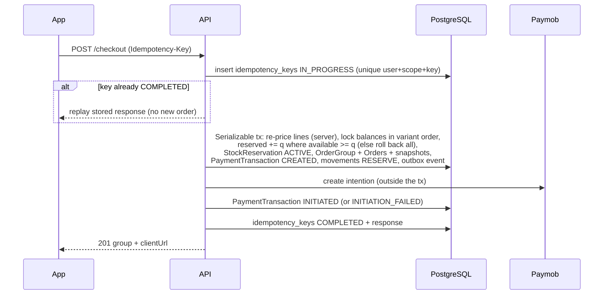
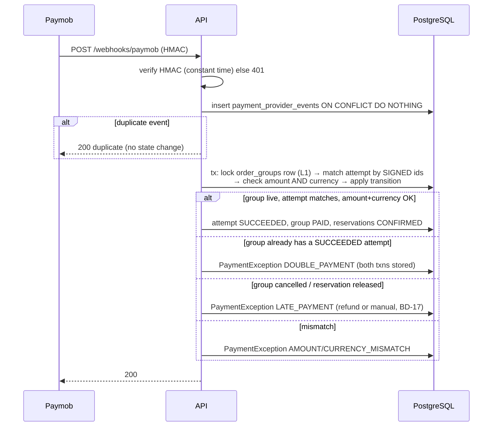
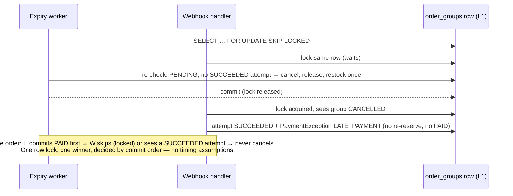
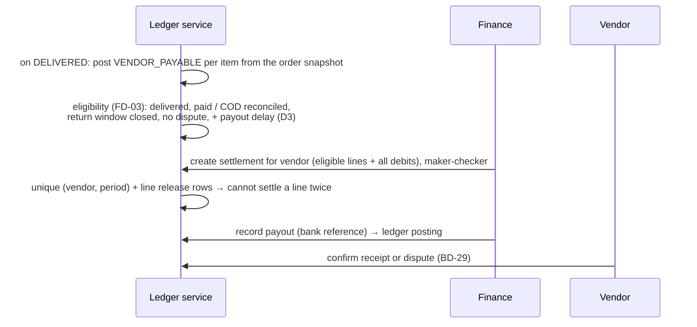

# 25 — Inventory, checkout, payment & COD hardening: audit, design reconciliation, decisions

> **Brief:** "Riven — Inventory, Checkout, Payment & COD Reliability Hardening" (Youssef, 2026-10-31).
> **This document delivers Stages A (audit), B (design) and C (business decisions).** *As first written (§1 – §8)*, Stages D and E had not started. **Superseded 2026-10-31:** S1 – S4 are implemented and tested (uncommitted) — **§9** (the slices) and **§10 – §12** (the review-round fixes) are the current state; where §2 – §8 say "today" or "not started", §9 – §12 win.
> **Read with:** `02` (data model), `03` (state machines), `04` (ledger), `05` (race matrix), `08` (decision register), `21` (reservation & payment expiry), `23` (R0–R4 roadmap), `payments-module-spec2.md`, `inventory-module-spec.md`, `fulfilment-module-spec.md`, `vendor-settlement-spec.md`.
> **Key finding:** almost every requirement of the brief is **already designed** in the commerce documents (2026-10-24 → 10-28) and waits on recorded decisions. This document does not redesign; it maps the brief onto that design (§3), lists the few genuine gaps (§4), and states what can be built now versus what is blocked (§6). The audit (§2) is of the **code**, verified on 2026-10-31.

---

## 1. Business context in the brief vs the decision register

The brief states several things as facts. In `08` they are still **pending**. They are not marked approved here; §5 asks for confirmation.

| Brief says | Register | Effect if confirmed |
|---|---|---|
| Riven owns and operates the warehouse; Riven stores, picks, packs and ships | **BD-01** (custody), **BD-02** (Riven fulfils), **BD-08** (verified before sold) — PENDING IBRAHIM | unblocks the warehouse design (Phase 1–2, 4) and the end of vendor self-fulfilment |
| "Riven purchases **or** receives products from vendors" | **BD-03** (legal ownership: purchase vs consignment) — PENDING IBRAHIM | decides whether vendors are paid per unit received or per unit sold (§5 D2) |
| Vendors paid after **15 days**, start event unknown | **FD-03** (payout eligibility and cycle) — PENDING; the 15-day figure is **new input** | §5 D3 |
| Customer pays the delivery charge, shown separately | **FD-29** approved (flat 80.00 EGP per order); **FD-18** (revenue vs pass-through) pending | fee line exists in the design; accounting needs FD-18 |
| COD is part of the model | Phases 4–5; **BD-05, BD-13, BD-14, FD-05, FD-06, FD-10, FD-25** pending; COD disabled in production until the Phase 5 exit (COU-01) | §5 D5 |

---

## 2. Stage A — audit of the code (verified 2026-10-31, working tree incl. uncommitted R0–R3/B1)

### 2.1 Inventory

| | |
|---|---|
| **Current** | One counter per variant: `ProductVariant.stockQuantity` (`prisma/schema.prisma`). It already means "available": checkout decrements it, cancel/expiry increment it. No on-hand / reserved split, no reservation rows, no movement ledger, no warehouse. |
| **Writers** (every path that changes stock) | 1. `VendorsRepository.createProductVariant` — initial value. 2. `VendorsRepository.updateProductVariant` (`vendors.repository.ts:327`) via `PATCH /vendors/me/products/:id/variants/:variantId` — **absolute** set from the DTO. 3. `CheckoutRepository.createOrderGroup` (`checkout.repository.ts:111`) — `decrement`, ascending variant id, Serializable, rollback if `< 0`. 4. `OrdersRepository.cancelPendingGroup` (`orders.repository.ts:230`) — `increment` once per variant (shopper cancel, admin cancel, expiry). Reads: cart soft check (`cart.service.ts:49,79`), checkout pre-check (`checkout.service.ts:140`). |
| **Weaknesses** | **W-INV-1 (critical):** writer 2 overwrites the counter. A vendor saving "10" while a checkout takes 2 waits for the checkout's row lock, then writes 10 → the 2 reserved units are sold again (oversell); a later cancel adds 2 more (inflation). **W-INV-2:** no `CHECK (stockQuantity >= 0)` — only the checkout code prevents negatives. **W-INV-3:** no audit trail of who changed stock, when, why. **W-INV-4:** "available" is the vendor's declared number, not verified warehouse stock (contradicts brief rule 1; BD-08). |
| **Root cause** | Phase-0 single-counter model; TD-08 (delta/CAS vendor API) still pending; ledger (`InventoryMovement`) designed in `02` but not built. |
| **Preserve** | Serializable checkout with sorted decrement and full rollback; exactly-once restock under the group lock (R0, tested ×200). |

### 2.2 Checkout

| | |
|---|---|
| **Current** | `CheckoutService.checkoutCart` → `CheckoutRepository.createOrderGroup`: one Serializable transaction re-validates every cart line, creates one `OrderGroup` + one `Order` per vendor + `OrderItem.priceSnapshot` (server-side price: variant `priceOverride` else product `basePrice`), decrements stock in ascending variant order, empties the cart. After commit, `PaymobService.createIntention` with `special_reference = og:<groupId>`; failure → `paymentSetupFailed: true`. Limit 10/min per user. |
| **Weaknesses** | **W-CO-1:** no idempotency key — a client that retries after a timeout (first request committed, response lost) gets **CART_EMPTY** if the cart was already emptied, or, if the cart was refilled, a **second group with a second reservation**. **W-CO-2:** no payment-attempt record; the intention ids are columns on `OrderGroup`, so attempts and failures leave no history. **W-CO-3:** `retry-payment` returns 400 `PAYMENT_ALREADY_SET_UP` when an intention exists, so a shopper who closed the payment page cannot reopen it (R25). **W-CO-4:** no payment method, address, delivery fee or Riven markup in the order money (FD-29/FD-02 not built). **W-CO-5:** prices are `Decimal(12,2)` while the paid amount is `Int` piastres — two representations (FD-01). |
| **Preserve** | all-or-nothing transaction, price snapshots, sorted locking, rate limit. |

### 2.3 Paymob webhook

| | |
|---|---|
| **Current** | One route (`infra/paymob`). HMAC verified with length check + `timingSafeEqual`; missing/invalid → 401. `PaymobWebhookDispatcher.toPaymentEvent` keeps only `success === true && !pending && !error_occured`. `OrderPaymentHandler` matches on **signed** ids (`order.id` / intention), checks `amount_cents` against the non-cancelled total, then `CheckoutRepository.recordPayment`: `UPDATE order_groups SET paymobTransactionId … WHERE id AND paymobTransactionId IS NULL` (claims once; `paymobTransactionId` is `@unique`), then PENDING orders → PAID. |
| **Strengths** | replay of the same webhook = no write (unique + guarded claim); two concurrent identical webhooks = one claim; amount mismatch never marks paid; PAID and CANCELLED never coexist (R0 test "expiry ∥ payment webhook" ×200). |
| **Weaknesses** | **W-PAY-1 (critical, financial):** a **second, different successful charge** on the same group is only **logged** (`order-payment.handler.ts`) — the second provider transaction is stored nowhere, so it can be lost (brief §5 "never silently discard"). **W-PAY-2:** a **late payment** (group already cancelled/expired) records the transaction id on the group but creates no exception record — only a log line "needs a human". **W-PAY-3:** **currency is not checked**. **W-PAY-4:** declined, voided and refunded callbacks are not stored; a signed callback with `success: true` and a refund/void flag would be parsed as a payment and, since the group already holds a transaction id, misclassified as a double charge (flag names unverified until the sandbox check, B15). **W-PAY-5:** raw provider events are not persisted — no evidence trail for disputes. **W-PAY-6:** no reconciliation with Paymob for intentions whose webhook never arrives (TQ-01). |
| **Root cause** | payment design (`PaymentTransaction`, `PaymentProviderEvent`, `PaymentException` — `02` §3.4, payments spec2 §3) deferred to the Paymob activation milestone (TD-21). |

### 2.4 Expiry, cancellation, restock (built 2026-10-29, R0)

| | |
|---|---|
| **Current** | `ReservationExpiryService` (every 10 min via BullMQ, or `POST /admin/maintenance/expire-overdue`): keyset batches, `FOR UPDATE SKIP LOCKED` on the group row, re-validation (all orders PENDING, no recorded transaction), guarded order updates, restock per variant ascending, Serializable + bounded retry, `lock_timeout`/`statement_timeout`, `MaintenanceRun` records, stale-run close. Shopper/admin cancel use the same method with a waiting lock. |
| **Weaknesses** | **W-EXP-1:** the TTL is **not payment-method aware** — a COD order would be cancelled after 60 min (`23` §11.1a); COD must not be enabled before method-scoped eligibility. **W-EXP-2:** the late-payment outcome is a log line (W-PAY-2). |
| **Preserve** | everything here; it is the model for the target W3/W7 lock sequences. |

### 2.5 State model

| | |
|---|---|
| **Current** | One `Order.status` (`PENDING → PAID → FULFILLED → SHIPPED → DELIVERED`, `CANCELLED`) carries payment, fulfilment and delivery. No group payment status (only the `paymob*` columns), no shipment, no COD, no settlement state. **The vendor** fulfils and ships (`PATCH /vendors/me/orders/:id/status`). |
| **Weaknesses** | **W-STATE-1:** payment is inferred from order status (brief §7). **W-STATE-2:** vendor self-fulfilment contradicts "Riven fulfils" (BD-02; `03` §13 already plans 409 `FULFILMENT_MANAGED_BY_RIVEN`). |

### 2.6 COD, warehouse, settlement

**Not built at all:** no payment method field, no shipment/courier/collection/remittance models, no warehouse or reservation rows, no ledger, no vendor balances, statements, settlements or payouts. (All designed: `02` §3.5–3.10, `03` §6–11, `04`, fulfilment spec, settlement spec.)

### 2.7 Background jobs and outbox (built R1–R3)

BullMQ schedules (expiry 10 min, outbox drain 5 min, bazaar auto-complete 15 min) with a reconciler, retention settings and `attempts: 1` per scheduled run (the next run is the retry); a separate worker process option; outbox tables with leases, retries, DEAD and append-only triggers — **no producers or consumers yet**. Health monitors expose expiry and outbox conditions. **Missing for this brief:** payment reconciliation worker, alerts for late/duplicate payments (they don't exist as records yet), COD and settlement jobs.

### 2.8 Database integrity today

| Exists | Missing |
|---|---|
| `order_groups.paymobTransactionId` UNIQUE; rating score CHECK; bazaar date CHECK; barcode/outbox CHECKs and triggers; explicit `onDelete` everywhere | `stockQuantity >= 0` CHECK; quantity > 0 CHECKs on cart/order items; idempotency keys; payment-attempt / provider-event uniqueness; currency columns |

---

## 3. Stage B — design: the brief mapped onto the existing design

The target design already exists; this table is the index. "Gap" means the brief asks for something the design does not have yet (detailed in §4).

| Brief § | Requirement | Existing design | Gap |
|---|---|---|---|
| 3 | onHand / reserved / available, `available = onHand − reserved` | `InventoryBalance` (`onHand`, `reserved`, quarantine, damaged…) per variant **per warehouse**, CHECKs `reserved ≤ onHand`, all ≥ 0 (`02` §3.5, inventory spec §2, §13) | naming only (`onHand`/`reserved` match) |
| 3 | auditable movement ledger with before/after, actor, reason | `InventoryMovement` append-only, trigger-protected, `MovementType` incl. OPENING_BALANCE, RESERVE/RELEASE, VENDOR_ADJUSTMENT, INTAKE_*, SHIPMENT_OUT, STOCKTAKE_ADJUSTMENT (`02`) | — |
| 3 | no unsafe absolute vendor stock writes | TD-08 (delta / compare-and-set); after custody, vendors cannot change warehouse stock at all — only intake (`19`) | TD-08 still pending |
| 3, 9 | receive, adjust, stock count, discrepancies | intake + handover discrepancies (`19`), stocktake (`03` §6.5), adjustments with approval (BD-38) | — |
| 3, 9 | single warehouse now, more later | `Warehouse` table with `sellable`; BD-21 multiple warehouses DEFERRED | — |
| 9 | when reserved stock is committed | `StockReservation ACTIVE → CONFIRMED → FULFILLED`: **FULFILLED at shipment HANDED_TO_COURIER** (`onHand −= q, reserved −= q`, movement SHIPMENT_OUT; `03` §6.1, §7) | — |
| 4 | atomic, idempotent checkout, price snapshots, payment record | Serializable checkout + `IdempotencyKey` (`02` §3.3, TD-07) + `PaymentTransaction` CREATED before the provider call (payments spec2 §3.1) | TD-07 pending |
| 5 | payment attempts, provider events, unique provider ids, exceptions | `PaymentTransaction`, `PaymentProviderEvent` (insert `ON CONFLICT DO NOTHING`), `PaymentException`, outcomes incl. `double_payment`, `currency_mismatch` (payments spec2 §3.2, `02` §3.4) | refund/void classification rule (§4 G3) |
| 6 | payment vs expiry race | lock order L1 (group row) first on every writer; expiry skips locked groups; a group with a SUCCEEDED attempt is never cancelled; late success → `PaymentException` (`03` §3.1, `05`, `21`) | the **business outcome** of a late success is BD-17 (§5 D4) |
| 7 | separate state machines | order group, group payment, payment transaction, reservation, shipment, COD collection, remittance, refund, settlement, payment exception — each in `03` | — |
| 8 | COD lifecycle | `CodCollection NOT_COLLECTED → COLLECTED_BY_COURIER → REMITTED_TO_RIVEN → RECONCILED` (+ PARTIAL, FAILED, DISPUTED, WRITTEN_OFF), `CourierRemittance`, reconciliation report, discrepancies (fulfilment spec §4, `03` §8) | method-aware expiry before enabling (W-EXP-1) |
| 10 | settlement with immutable snapshots, fees, refunds, history | double-entry ledger (`04`), `VENDOR_PAYABLE` per delivered item, statements, settlements, payouts, receipt confirmation (settlement spec) | **15-day rule** (§4 G1, §5 D3) |
| 11 | DB constraints | hand-SQL CHECKs, partial uniques, append-only triggers (`02` §5) | `stockQuantity ≥ 0` can be added **now** on today's model |
| 12 | outbox, idempotent jobs, monitoring | outbox built (R3); jobs and alerts designed per phase (`13`, `22`) | payment/COD/settlement alerts come with their phases |

### 3.1 Sequence diagrams (target design, as specified in `03` / `21` / payments spec2)

**Checkout (target)**



**Webhook (target)**



**Payment success racing expiry — the authoritative transition**



Today's code already behaves this way for the PAID-vs-CANCELLED outcome (W-PAY-2 aside: the late payment is only logged).

**COD (target, Phases 4–5)**

```mermaid
sequenceDiagram
  participant S as Shopper
  participant API
  participant OPS as Riven ops
  participant C as Courier
  participant FIN as Finance
  S->>API: checkout paymentMethod=COD
  API->>API: reserve stock; PaymentTransaction AWAITING_COLLECTION
  OPS->>API: COD confirmation call (BD-13) → CONFIRMED (or cancel → release)
  OPS->>API: pick, pack, shipment READY_FOR_PICKUP
  OPS->>API: HANDED_TO_COURIER + signed manifest → reservations FULFILLED (stock leaves),<br/>CodCollection NOT_COLLECTED
  C->>S: deliver, collect cash
  OPS->>API: DELIVERED + COLLECTED_BY_COURIER (one per shipment, unique)
  C->>FIN: remits cash (batch)
  FIN->>API: CourierRemittance recorded (amount, reference) → collections REMITTED_TO_RIVEN
  FIN->>API: reconcile: expected vs remitted → RECONCILED or discrepancy (FD-05/FD-06)
  Note over API: Only RECONCILED cash makes the vendor payable eligible (settlement spec §3)
```

**Settlement (target, Phase 6)**



---

## 4. Stage B — genuine gaps (new relative to the existing design)

| # | Gap | Proposal |
|---|---|---|
| **G1** | The **15-day** payout delay is new; FD-03's eligibility list has no fixed delay | add "and `eligibleAt = <start event> + PAYOUT_DELAY_DAYS` has passed" as condition 6 of settlement spec §3; the start event is decision D3; `PAYOUT_DELAY_DAYS` is configuration with history like the markup (TD-15 pattern) |
| **G2** | The brief's 27 acceptance scenarios are not all named in `14` | map each to an AT/C id (§7); add the missing ones (#1 "10 buyers, last 3 units", #14 retry-payment attempts, #17 worker crash mid-processing) to `14` when Stage D starts |
| **G3** | Classification of non-payment callbacks (refund, void, decline) | store **every** signed callback (already designed, R20) and classify by explicit flags (`is_refund`, `is_void`/`is_voided`, `is_capture`, `pending`, `success`) — **only** a non-refund, non-void, non-pending success is a payment; the exact flag names are verified in the Paymob sandbox (B15) before this ships |
| **G4** | Today's code (not the design) logs instead of storing double/late payments | first Stage D slice (§6 S1), independent of business decisions |
| **G5** | `stockQuantity ≥ 0` can be enforced on the **current** single-counter model before any inventory redesign | Stage D slice S2 |

---

## 5. Stage C — business decisions

None of these is approved by this document. Recommendations are defaults to discuss, not decisions.

### D1 — Does Riven take custody and do all fulfilment? (BD-01, BD-02, BD-08)
- **Question:** From when are products physically in Riven's warehouse, and does Riven (not the vendor) pick, pack and ship every marketplace order? Can a product be sold before Riven has received and checked it?
- **Example:** A vendor declares 30 shirts but only 25 arrive. If shoppers could buy against the declared 30, five orders cannot be shipped.
- **Options:** (a) custody + Riven fulfils + sell only verified stock (the brief's model); (b) keep vendor self-fulfilment for some vendors; (c) sell declared stock until intake.
- **Consequences:** (a) needs intake (`19`) before the first sale and removes the vendor status route (409 for Riven-fulfilled orders); (b) keeps two fulfilment paths forever; (c) brings back overselling.
- **Recommendation:** (a), as the brief states — **please confirm it is Ibrahim's decision** so BD-01/02/08 can be recorded as approved.

### D2 — Does Riven buy the goods or hold them on consignment? (BD-03)
- **Question:** "Riven purchases **or** receives products." When does the vendor earn money — when Riven receives the goods, or when a shopper's order is delivered?
- **Example:** 30 shirts arrive; 10 sell this month. Purchase: Riven owes the vendor for 30 now. Consignment: Riven owes for 10, and unsold stock can go back to the vendor.
- **Consequences:** purchase needs purchase orders and stock valuation; consignment matches the existing design (vendor payable per delivered item, `04` §7.5, withdrawals `19`).
- **Recommendation:** consignment (already designed). Legal check of ownership and loss liability (FD-07) still needed.

### D3 — When do the 15 days start? (FD-03, new input)
| Start event | Example: order 1 Nov, paid 1 Nov, delivered 5 Nov, returned 12 Nov | Consequences |
|---|---|---|
| Order **creation** | eligible 16 Nov | vendor may be paid for an order that is later cancelled, refused at the door or returned → negative balances and clawbacks (FD-11); unpaid/COD orders could be paid out before Riven has the money |
| **Payment** | eligible 16 Nov | same return/refusal risk; **undefined for COD** (payment happens at delivery, cash arrives later) |
| **Delivery** (and COD reconciled) | eligible 20 Nov; the 12 Nov return is known before payout | safest; matches the designed eligibility (delivered + paid/reconciled + return window closed); the 15 days can **be** the return window if BD-04 sets a ≤ 15-day window |

**Recommendation:** 15 days after **delivery**, and never before COD cash is reconciled; set BD-04's return window to fit inside those 15 days so returns rarely hit an already-paid line.

### D4 — A payment that succeeds after the order expired (BD-17)
- **Question:** The shopper pays at minute 61; the reservation was released at minute 60. Refund, or try to honour the order?
- **Options:** (a) always record + `PaymentException LATE_PAYMENT` → refund (manual until a refund process exists); (b) if stock is still available, re-reserve and honour the order, otherwise refund.
- **Consequences:** (a) simple and deterministic, but annoys the shopper; (b) better experience, but a second reservation path inside the webhook and more race cases (`05`).
- **Recommendation:** (a) now; (b) later if late payments turn out to be frequent.

### D5 — COD rules before COD is switched on (BD-05, BD-13, BD-14, FD-05, FD-06, FD-10, FD-25)
| Question | Example | Recommended default |
|---|---|---|
| Confirmation call required? window? (BD-13) | unreachable shopper keeps stock blocked | required; 24 h; unreachable → cancel and release |
| How long a COD order may hold stock (method-aware expiry, W-EXP-1) | today the generic 60 min would cancel every COD order | until confirmation window ends, then until handover; never the 60-min online-payment TTL |
| Refusal limit (BD-05) | a shopper refuses 3 deliveries | block COD after 2 refusals in 90 days |
| Maximum COD order value (BD-14) | a 25,000 EGP order | a cap per order (amount for Ibrahim) |
| Short collection / wrong remittance (FD-05) | courier remits 1,950 of 2,000 | discrepancy record, courier liable, Finance resolves; never auto-written-off |
| Partial remittances and frequency (FD-06, FD-10) | courier remits weekly in batches | needs the courier contract (TQ-04) |
| Loss/damage in courier custody (FD-25) | parcel lost after handover | courier liable per contract; vendor still paid per D2 |

COD stays **disabled in production** until these and the Phase 5 exit criteria are met (COU-01).

### D6 — Delivery fee accounting (FD-18)
The amount is approved (80.00 EGP flat, FD-29). Still open: is it Riven revenue (Riven pays the courier) or money held for the courier (pass-through)? It changes the ledger accounts and VAT treatment, not the shopper's price. **Recommendation:** Riven revenue, courier cost booked separately.

### D7 — Money representation (FD-01)
Integer piastres (`Int`) everywhere, with a 3-letter currency column on every money record. Today prices are `Decimal(12,2)` and paid amounts `Int`. **Recommendation:** integer minor units + `currency = 'EGP'`; existing decimals converted by an additive migration (old columns kept until cut-over, `06`).

### Technical decisions (Youssef)
| Id | Decision | Recommendation |
|---|---|---|
| TD-08 | vendor stock API: delta (`{ change: -3, reason }`) or compare-and-set (`{ expected: 10, stockQuantity: 8 }` → 409 if changed) | **delta + reason**, recorded as VENDOR_ADJUSTMENT movements, refused below the reserved quantity; becomes intake-only once D1 is live |
| TD-07 | `Idempotency-Key` optional or required on `POST /checkout` | optional on the current route (the mobile app does not send it yet), required on `/v1` |
| TD-04 | extend `AdminAuditLog` (actor type, before/after) for inventory and financial actions | yes, before the ledger slices |

---

## 6. Stage D — proposed increments (not started)

> *Superseded:* S1 – S4 are implemented (§9 – §12); S5 – S6 still not started.

Each slice is small, independently testable, and keeps every existing route working.

| Slice | What | Needs | Schema | Migration / rollout risk |
|---|---|---|---|---|
| **S1** | Webhook hardening on today's model: persist every signed callback (`payment_provider_events`, unique provider transaction id + event type), record `DOUBLE_PAYMENT`, `LATE_PAYMENT`, `AMOUNT_MISMATCH`, `CURRENCY_MISMATCH` as `payment_exceptions` rows (admin list + resolve, audited), currency check, refund/void/decline classification (G3) | Youssef approval; sandbox check of flag names before production | 2 additive tables + enums | none for existing data; behaviour for existing successful payments unchanged |
| **S2** | `CHECK (stockQuantity >= 0)` + `CHECK (quantity > 0)` on cart and order items | approval | hand SQL | pre-check: `SELECT … WHERE stockQuantity < 0` must return 0 rows on every database (local, test, Supabase) before deploy |
| **S3** | TD-08: vendor stock becomes delta + reason, refused below 0; `inventory_movements` ledger on the single counter (OPENING_BALANCE from today's values, RESERVE at checkout, RELEASE at cancel/expiry, VENDOR_ADJUSTMENT) | TD-08 decision | 1 append-only table + trigger | **breaking** for `PATCH …/variants/:id` `stockQuantity` (mobile app and dashboards must switch); keep the absolute field for one release behind a deprecation response header only if you want a transition window |
| **S4** | Checkout `Idempotency-Key` (`idempotency_keys`) | TD-07 | 1 table | none (header optional) |
| **S5** | `PaymentTransaction` attempts; `retry-payment` reopens a live attempt (R25); Paymob reconciliation worker (TQ-01) | Paymob activation milestone (TD-21), sandbox | additive + legacy projection (`06` §4) | legacy `paymob*` columns kept and projected |
| **S6+** | warehouse balances and reservations (onHand/reserved), intake, Riven fulfilment and shipments, COD, ledger and settlement | D1–D7 + phases 1–6 of `16`/`23` | as designed in `02` | per phase, as in `06` |

**Existing data is preserved:** nothing is deleted or rewritten. Today's `stockQuantity` becomes the OPENING_BALANCE movement (S3) and later the vendor-declared opening balance at the vendor's premises (`06` §3.5); existing orders keep their status and snapshots and are projected into the new state fields; historical payments stay on `order_groups` and are projected, not migrated away.

**Rollback per slice:** revert code; keep additive tables and enum values (as R0).

---

## 7. Stage E (planned) — the brief's acceptance tests, mapped

Status today: ✅ covered by an existing real-DB test · 🟡 partial (unit only / different shape) · ❌ none. "Slice" = where it gets built.

> *Superseded:* the "Today" column is the state **before** S1 – S4. Tests #1 – #4, #7 – #13 and #17 now exist on real PostgreSQL (§9 lists them per slice); the rest wait for S5 / COD / warehouse.

| # | Scenario | Today | Slice |
|---|---|---|---|
| 1 | 10 buyers, last 3 units → exactly 3 reserved | 🟡 checkout rolls back below 0; no 10-way concurrent test | S2 (add now) |
| 2 | two checkouts, last unit → one succeeds | 🟡 same | S2 |
| 3 | inventory adjustment during checkout → no lost update | ❌ **fails today** (W-INV-1) | S3 |
| 4 | failed checkout leaves no partial reservation | 🟡 rollback by design, no explicit test | S2 |
| 5 | release twice → restock once | ✅ R0 "expiry ∥ cancel" ×200 | — |
| 6 | expired reservation released once | ✅ R0 overlapping runs ×200 | — |
| 7 | available never negative | 🟡 code only | S2 (DB CHECK) |
| 8 | same webhook 10× → one transition | 🟡 unit (replay = no write) | S1 (real DB) |
| 9 | two identical webhooks at once → one | 🟡 unit (guarded claim) | S1 (real DB) |
| 10 | two different successful charges → duplicate detected | 🟡 detected but **only logged** | S1 |
| 11 | webhook after expiry → late payment + exception | 🟡 recorded on the group + log | S1 |
| 12 | invalid signature rejected | ✅ unit (HMAC, dispatcher) | — |
| 13 | amount and currency mismatch rejected | 🟡 amount only | S1 |
| 14 | payment-intention retry → no unintended duplicate attempts | 🟡 retry refused when an intention exists | S5 |
| 15 | payment ∥ expiry → one winner | ✅ R0 "expiry ∥ payment webhook" ×200 | — |
| 16 | never restore or reserve twice | ✅ R0 | — |
| 17 | worker crash mid-processing → consistent | 🟡 per-group transactions + stale-run close tested; no kill test of the webhook path | S1 |
| 18–23 | COD collection, duplicates, remittance, wrong amount, failed delivery, cancellation | ❌ COD not built | Phase 5 (after D5) |
| 24–27 | settlement from snapshots, refunds/adjustments, not before eligibility, no double payout | ❌ settlement not built | Phase 6 (after D2, D3, FD-11) |

---

## 8. What I need from you to continue

> *Superseded by §9:* items 2 (position recorded, FD-03 still pending Ibrahim) and 4 are answered; items 1 and 3 (D1, D2, D4, D5) are still open.

1. **Confirm D1** (custody + Riven fulfilment + verified-only selling) and **D2** as Ibrahim's decisions, or send them to him.
2. **D3:** which event starts the 15 days.
3. **D4** and the **D5** COD defaults (or "not yet" — COD can wait; nothing above depends on it except Phase 5).
4. **Technical approval** of slices **S1** and **S2** (no business decision needed; 2 additive tables + CHECKs), and your choice for **TD-08** (S3) and **TD-07** (S4).

Until then, nothing in Stage D starts. Riven is **not** production-ready for real orders: see W-INV-1, W-PAY-1 and the production gate (BD-33, `10` §6).

---

## 9. Decisions recorded and implementation status (2026-10-31)

**Youssef, 2026-10-31:** S1 and S2 approved to start; **TD-08 = delta + reason** (APPROVED; slice S3 implemented the same day, below); **TD-07 = `Idempotency-Key` optional now, required on `/v1`** (APPROVED; slice S4 implemented the same day, below); **D3 position: the 15 days start at delivery** (recorded on FD-03, still PENDING IBRAHIM). D1, D2, D4, D5, D6, D7 unchanged (pending). Nothing is committed or pushed.

### S2 — stock and quantity constraints (implemented)
- Migration `20261031000000_stock_and_quantity_checks`: `CHECK ("stockQuantity" >= 0)` on `product_variants`, `CHECK ("quantity" > 0)` on `cart_items` and `order_items` (pre-check queries in the file; local `riven` and `riven_test` had 0 violating rows).
- Checkout decrements with a conditional update (`stockQuantity >= q`) instead of decrement-then-check, so it never trips the CHECK; zero rows updated = out of stock → whole checkout rolls back (`checkout.repository.ts`).
- `AllExceptionsFilter`: a CHECK violation (SQLSTATE 23514) from any writer is **409 `CONSTRAINT_VIOLATION`**, not a 500.
- Tests (`checkout-concurrency.e2e.spec.ts`, real PostgreSQL, independent connections): **#1** 10 buyers / last 3 units → exactly 3 succeed, stock 0, 3 units on orders (×10); **#2** two buyers / last unit → exactly one (×10); **#4** a checkout failing on one line reserves nothing and leaves the cart; the in-transaction decrement stops an oversell the pre-check missed (×10); **#7** the database refuses negative stock and non-positive quantities.

### S1 — webhook hardening (implemented)
- Migration `20261031010000_payment_events_and_exceptions` (additive): `payment_provider_events` (every signed callback; unique `(provider, providerTransactionId, kind)`; append-only trigger except `outcome/handler/processedAt`), `payment_exceptions` (`DOUBLE_PAYMENT`, `LATE_PAYMENT`, `AMOUNT_MISMATCH`, `CURRENCY_MISMATCH`; unique `(type, provider, providerTransactionId)`; never deleted, facts immutable, `OPEN → RESOLVED` once with who/when/note enforced by CHECK + trigger), `AdminAction.PAYMENT_EXCEPTION_RESOLVED`, `AdminTargetType.PAYMENT_EXCEPTION`.
- `PaymobWebhookDispatcher`: classifies every signed callback from **signed fields only** (`classifyPaymobTransaction`: PAYMENT / DECLINED / PENDING / REFUND / VOID / OTHER — G3), stores it before anything is applied, treats an already-processed callback as a duplicate, offers only PAYMENT to handlers, marks it processed after the handler; a crash leaves it unprocessed for the provider's retry. The amount no longer falls back to the unsigned `order.amount_cents`.
- `CheckoutRepository.applyPayment` (replaces `recordPayment`): one transaction that takes the **order-group row lock first** (same as expiry/cancel, `lock_timeout` 5 s, `statement_timeout` 15 s, retried on serialization/deadlock), decides with the pure `decidePayment` (`payment-decision.ts`), then writes the claim, PENDING → PAID and any exception **together**. Currency must be `EGP`.
- Admin: `GET /admin/payment-exceptions` (filters status, type, orderGroupId), `GET /admin/payment-exceptions/:id`, `PATCH /admin/payment-exceptions/:id/resolve` `{ note }` (10 – 1,000 chars; 409 if already resolved; audited). Resolving moves no money (no refund automation, FD-12).
- Monitoring: `GET /health/maintenance` raises **`PAY-EXC` (P2)** while any exception is OPEN.
- Tests: `payment-webhook.e2e.spec.ts` (real PostgreSQL, real HMAC): **#8** same webhook ×10 → one event, one transition; **#9** 10 identical webhooks at once → one transition (×5); **#10** a second different charge → `DOUBLE_PAYMENT` with its own transaction stored, first kept, idempotent, also when both arrive at once (×5); **#11** payment after cancellation → `LATE_PAYMENT`, orders stay cancelled; **#12** bad/tampered signature → 401, nothing stored; **#13** amount and currency (USD / missing) mismatches → exceptions, not applied; refund/void callbacks stored, never mistaken for a charge; **#17** crash mid-apply → unprocessed → retry applies exactly once; triggers and CHECKs refuse deletes and history rewrites. `reservation-expiry.e2e` race "expiry ∥ payment" now drives `applyPayment` and asserts exactly one `LATE_PAYMENT` when expiry wins (×20). Unit: `payment-decision.spec.ts`, `order-payment.handler.spec.ts`, `paymob-webhook.dispatcher.spec.ts`, `payment-exceptions.service.spec.ts`, controller spec; smoke steps for the three routes and `PAY-EXC`.

### S3 — stock ledger + vendor delta (implemented, TD-08)
- Migration `20261031020000_inventory_movements`: `inventory_movements` (OPENING_BALANCE / RESERVE / RELEASE / VENDOR_ADJUSTMENT; signed `quantityDelta`, `quantityBefore`, `quantityAfter`, order group, actor, `source`, reason). CHECKs: after = before + delta, after ≥ 0, delta ≠ 0 (except opening), RESERVE negative / RELEASE positive, RESERVE/RELEASE must name the order group; append-only trigger. **Backfill:** one OPENING_BALANCE row per existing variant = its stock at migration time, so `SUM(quantityDelta) = stockQuantity` from day one (local `riven`: 16 variants, 0 mismatches).
- Writers: checkout (`UPDATE … WHERE stock >= q RETURNING` → RESERVE with group + shopper), `cancelPendingGroup` (RELEASE with source `shopper_cancel` / `admin_cancel` / `expiry` and the actor), vendor create-variant (initial stock) and the new delta route — each in the same transaction as the counter change.
- **API change (breaking for absolute writes):** `PATCH /vendors/me/products/:id/variants/:variantId` no longer accepts `stockQuantity` (400). New: `POST …/variants/:variantId/stock-adjustments` `{ change ≠ 0, reason 3–500 }` → 201 `{ variantId, stockQuantity, movement }`, `409 STOCK_BELOW_ZERO` if the result would be negative (reserved units can never be taken back); `GET …/variants/:variantId/stock-movements` (vendor's own history); `GET /admin/inventory-movements` (filters variant, product, order group, type). The mobile app only reads `stockQuantity`, so it is unaffected.
- Tests (`inventory-and-idempotency.e2e.spec.ts`, real PostgreSQL): **#3** 5 vendor adjustments racing 10 checkouts → stock = start + applied adjustments − units sold, never negative, ledger = counter (×10); a vendor cannot take back reserved units; every writer leaves the expected row; the ledger is append-only and its arithmetic and order link are enforced. Unit + controller specs; smoke steps (absolute write → 400, +2 → 201, below zero → 409, change 0 → 400, history, admin ledger, ledger = counter at the end of the run).

### S4 — checkout `Idempotency-Key` (implemented, TD-07)
- Migration `20261031030000_idempotency_keys`: `idempotency_keys` unique `(userId, scope, key)`, `orderGroupId` unique, CHECKs (a COMPLETED key has a stored response; key not blank).
- Optional header on `POST /checkout` (8–128 chars `[A-Za-z0-9._:-]`, else 400 `IDEMPOTENCY_KEY_INVALID`). The key is linked to the order group **inside the checkout transaction**, so "order exists" and "key points to it" commit together. Same key again → the stored response (or, after a crash between commit and storing it, a response rebuilt from the order); still running → `409 IDEMPOTENCY_KEY_IN_PROGRESS` (lock 60 s); failed before an order → key freed for a corrected retry; expired (24 h) → reusable. No header → unchanged.
- Tests: retry after a lost response → same group, stock taken once; 5 simultaneous requests with one key → exactly one order (×10); failed checkout frees the key; different keys / no key → separate orders. Unit tests for every branch; smoke replay step.

### Still open from the brief
- **S5** (payment attempts, reopen a live intention, reconciliation worker) — waits for the Paymob activation milestone and the sandbox check of the flag names (B15).
- COD, warehouse, settlement (S6+) — wait for D1 – D7.

### Deployment notes for S1 – S4
- Apply all five migrations (`20261031000000` … `20261031040000`) **before** the new code (`prisma migrate deploy`); run the S2 pre-check queries on Supabase first.
- **Ledger catch-up (S3):** the OPENING_BALANCE backfill runs inside the migration. If the old code keeps writing stock between `migrate deploy` and the new code going live, `SUM(quantityDelta)` drifts from `stockQuantity` and `/health/maintenance` raises `LEDGER-DRIFT`. Run `apps/api/scripts/ledger-catch-up.sql` once, right after the new code is live: its SELECT lists the drifted variants, its INSERT adds one OPENING_BALANCE catch-up row per variant (append-only, nothing rewritten).
- **Breaking for clients:** the vendor variant PATCH refuses `stockQuantity` (use the stock-adjustment route); `POST /media/upload-url` now requires `contentLength`.
- Rollback: revert the code; keep the tables, constraints and enum values (additive). If the S2 CHECKs must be dropped: `ALTER TABLE … DROP CONSTRAINT …` (names in the migration).
- e2e suites that delete order groups now `TRUNCATE "payment_exceptions"` first (its rows are never deleted by design).

---

## 10. Review round 1 — findings fixed (2026-10-31)

Three independent read-only reviews (correctness, security, docs/business logic) of §9 found the issues below. All are fixed in code and tests unless marked otherwise.

### Correctness
- **Double submit without a key** could create two orders: the checkout now deletes exactly the cart lines it priced (`id` + `quantity`), and fewer deleted rows than lines → `CartChangedError` → the whole transaction rolls back and the request re-reads the cart. Five simultaneous no-key submits → one order (e2e).
- **Isolation:** checkout runs at **READ COMMITTED with guarded writes** (conditional stock decrement that also requires `deletedAt IS NULL`, exact cart-line delete, guarded key link) inside `withRetryableTx`. Cancel and expiry stay Serializable. When retries are exhausted the answer is **503 `CHECKOUT_CONTENDED`** (retryable), never a 500.
- **Intent overwrite:** attaching the Paymob intention is a guarded update (`paymobIntentId IS NULL`); a concurrent retry-payment never replaces a live intention. `POST …/retry-payment` returns the **stored** payment page (`paymobClientUrl`, new column) when an intention exists.
- **Mismatches no longer claim the group:** only a correct payment sets `paymobTransactionId`. After `AMOUNT_MISMATCH` / `CURRENCY_MISMATCH` / `LATE_PAYMENT` the group stays unclaimed — still expirable by the reservation job and still payable by a later correct charge; the wrong charge stays on record as an exception for a manual refund.
- **Unmatched charges:** a correctly signed charge that matches no order group is recorded as **`UNMATCHED_PAYMENT`** (`orderGroupId` null, enforced by CHECK `payment_exceptions_group_required`), once.
- **Out-of-stock details:** `CHECKOUT_ITEM_UNAVAILABLE` has the same shape whether the pre-check or the in-transaction decrement finds the problem: `details: { items: [{ cartItemId, variantId?, reason }] }`.
- **Idempotency key held by a running request:** 409 `IDEMPOTENCY_KEY_IN_PROGRESS` even when the order already exists, until the first request stores its response.
- **Payment exception audit (TD-03 for this path):** resolving writes its `admin_audit_log` row **inside** the resolving transaction.
- **Amount bounds:** a signed amount outside 0 … 2³¹−1 is treated as missing (→ `AMOUNT_MISMATCH`).

### Security
- **Strict signed fields:** a correctly signed callback whose fields have the wrong type (`success: "true"`, non-integer ids or amount, bad currency or date) or whose `integration_id` differs from the configured one is refused and nothing is stored. Only JSON `true` counts as true.
- **Stored payload** is reduced to an allow-list of payment facts before it is kept as evidence: no billing or contact data; the card only as Paymob's masked `pan` and type.
- **Webhook throttle:** 600 requests/min on the single webhook route (was unthrottled).
- **Uploads:** `POST /media/upload-url` requires `contentLength` (1 B – 10 MB) and signs it into the presigned PUT, so the storage provider refuses a bigger body.
- **Production config:** with `NODE_ENV=production` the API refuses to boot with the placeholder JWT secret or the published dev passwords (`riven_dev_password`, `riven_dev_master_key`) in `DATABASE_URL`, `MEILISEARCH_API_KEY` or `S3_SECRET_ACCESS_KEY`. Development is unaffected.
- **Coded errors:** a wrong role is **403 `FORBIDDEN_ROLE`** (was `HTTP_ERROR`); a CHECK violation is matched on SQLSTATE `23514` only.
- **Privacy:** the vendor stock history no longer returns `actorUserId`.
- **Image URLs** must be `http(s)://` with a scheme. *Not done, by decision pending:* restricting image hosts to Riven's storage — the mobile app may still send external URLs, so this needs a product decision.

### Operations and drift (TD-02)
- `prisma/hand-sql-objects.json` registers every hand-written CHECK, trigger, function and partial/GIST index; `hand-sql-objects.e2e.spec.ts` fails if one is missing **or** an unregistered one appears; `pnpm --filter @riven/api check:drift` (`scripts/check-schema-drift.mjs`, also a CI step) fails if `schema.prisma` and the migrations disagree, allowing only the registered hand-SQL index statements.
- `/health/maintenance` adds **`PAY-STUCK` (P1)** — a PAYMENT callback stored but unprocessed for over 15 min — and **`LEDGER-DRIFT` (P2)** — any variant whose ledger sum differs from its counter.
- The smoke script polls the search absence checks (eventual consistency) instead of failing on the first read.

---

## 11. Review round 2 — findings fixed (2026-10-31)

Round 2 scored correctness 8.5, security 9, docs 8. Fixed:

### Security — signed-field shifting (closed at the root)
Paymob's HMAC concatenates the signed values with no delimiter, and a missing field adds nothing to that string. A shopper holds one valid signature (Paymob's redirect URL carries every signed field plus `hmac`), so digits could be moved across a field boundary — e.g. `id ‖ integration_id` with `integration_id` dropped — and the signature still verified. That could forge a `DOUBLE_PAYMENT` / `UNMATCHED_PAYMENT` exception, or (with `created_at ‖ currency` and a null currency) consume the transaction id before Paymob's genuine callback so the real payment was dropped as a duplicate.
- **Every** signed field used in a decision must now be present with its exact format: integer `id`, `order.id`, `integration_id`, `owner`, `amount_cents`; a complete `created_at` (anchored, optional fraction and zone); a 3-letter `currency`; all ten signed flags as JSON booleans. Otherwise the callback is refused and nothing is stored.
- The two integer pairs that touch are **pinned**: `integration_id` must equal `PAYMOB_INTEGRATION_ID` and `owner` must equal the new **`PAYMOB_MERCHANT_ID`**. Without both pins configured, no callback is trusted, and `PAYMOB_HMAC_SECRET` without both ids fails at boot. **Deploy note:** set `PAYMOB_MERCHANT_ID` (Paymob dashboard → profile) together with the other Paymob values when Paymob is enabled.
- Tests: unit cases for every missing field, the null currency, the trailing-character timestamp and both pins; a real-HMAC e2e builds the three forgeries, checks each verifies with the genuine signature, is refused with nothing stored, and the genuine callback still pays.

### Correctness
- **Double submit at low stock:** the checkout removes the priced cart lines **first**, so a duplicate waits on the first request and then gets `CART_EMPTY`, never `CHECKOUT_ITEM_UNAVAILABLE` (e2e, ×10).
- **Visibility inside the transaction:** the guarded decrement also requires the product active and not deleted and its vendor verified and not deleted (the `PUBLIC_PRODUCT_WHERE` rule in SQL). A product withdrawn after the pre-check is not sold and is reported as `PRODUCT_UNAVAILABLE` (e2e).
- **Contention never surfaces as 500:** one classifier (`isContentionError`: serialization failure, deadlock incl. a raw-query 40P01, lock timeout 55P03, transaction timeout P2028) drives the checkout retry loop (→ 503 `CHECKOUT_CONTENDED`) and the global filter (→ 503 **`SERVICE_BUSY`** on any other route, e.g. a cancel during a busy sale).
- **Explicit transaction limits** on checkout, cancel/expiry and payment (`maxWait` 10 s, `timeout` 20 s), so the database's own `lock_timeout` (5 s) and `statement_timeout` (15 s) answer first; P2028 is retried.

### Docs and tests
- Client docs (`postman-endpoints.md`, `web-dashboard-endpoints.md`) now mark every changed behaviour (503 `CHECKOUT_CONTENDED`, `Idempotency-Key`, retry-payment returning the stored page, required `contentLength`, `FORBIDDEN_ROLE`, `SERVICE_BUSY`).
- Webhook matching wording corrected everywhere: the signed `order.id` only; the transaction id only deduplicates.
- New tests: production config refusals and the Paymob pin rule (`env.validation.spec.ts`); expiry releasing a group that received only a wrong charge, with the exception kept (`reservation-expiry.e2e`).

---

## 12. Review round 3 — findings fixed (2026-10-31)

Round 3 scored correctness 9.5, security 10, docs 9. Fixed:

### Correctness — a checkout always ends inside its key's lock
A checkout could retry (3 repository attempts × 3 service attempts, each waiting up to Prisma's limits) for longer than the 60 s `Idempotency-Key` lock; a client retry with the same key could then take the key over while the first request was still running, and the first request's failure path could free the key the second now held.
- The checkout transaction sets its own `lock_timeout` (5 s) and `statement_timeout` (10 s), with Prisma limits `maxWait` 5 s / `timeout` 15 s.
- One **20 s deadline** covers every attempt in both retry layers (`withRetryableTx` gained a `deadline` option): no new attempt starts after it → 503 `CHECKOUT_CONTENDED`. Worst case ≈ 20 s + one 20 s attempt + the 10 s Paymob call = 50 s < 60 s.
- Releasing a key is **holder-aware**: it deletes the key only while its `lockedUntil` is still the value this request set (`releaseIdempotencyKey(id, heldUntil)`), so it can never free a key another request has taken over.

### Security (scored 10/10; two optional hardenings taken)
- A signed callback refused by the format/pin rules is logged at **ERROR** (it may be a genuine charge in an unexpected format and needs a human before the order expires). Nothing is stored for it, by design: storing it under its transaction id would let a forgery occupy that id.
- `PAYMOB_INTEGRATION_ID` and `PAYMOB_MERCHANT_ID` must not start with `0` (they are compared with the signed integers as strings).
- **Open, needs a sandbox payload:** confirm that `owner` equals the dashboard merchant id and the exact `created_at` format (alongside the existing `intention_order_id` check, CLAUDE.md Gotchas).

### Docs and tests
- `web-dashboard-endpoints.md` error example is the real flat body; 401 is `INVALID_ACCESS_TOKEN`; `SERVICE_BUSY` listed. `postman-endpoints.md` no longer claims PAID → CANCELLED. RIVEN-WORK-FLOW: exception precedence, the intention-id fallback match, the late-payment policy marked **pending BD-17**, transaction-limit wording.
- New real-DB tests: two payment setups racing on one group store exactly one intention and both callers get it (×10); if the in-transaction audit insert fails, the payment-exception resolution rolls back with it (TD-03). Unit: the release is bound to the holder's lock, also after a takeover; every attempt carries one deadline.

### Round 4 follow-up (correctness 9.5 → fixed)
- The 20 s deadline now gates **every** attempt after the first in the service loop, including the one after a changed cart (it previously only gated the contention path), so the "always inside the 60 s key lock" bound holds on every path.
- A statement cut off by `statement_timeout` (SQLSTATE 57014) is contention too: 503 `SERVICE_BUSY` / `CHECKOUT_CONTENDED`, not 500.
- Tests: `retryable-tx.spec.ts` (classification, attempt limit, no retry after the deadline); `checkout.service.spec.ts` (after a changed cart or contention past the deadline, no further attempt starts → 503).

